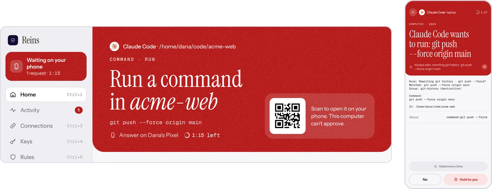
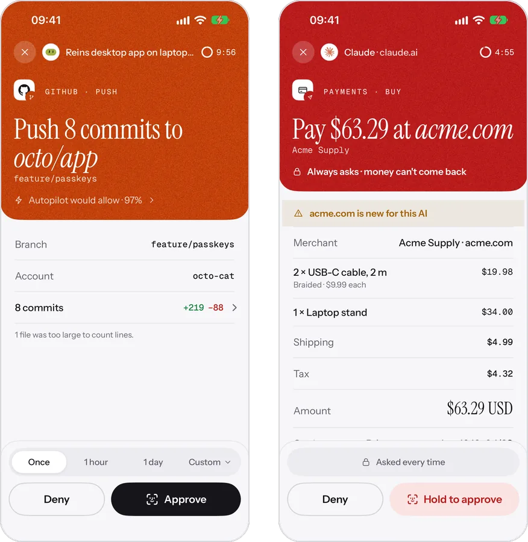
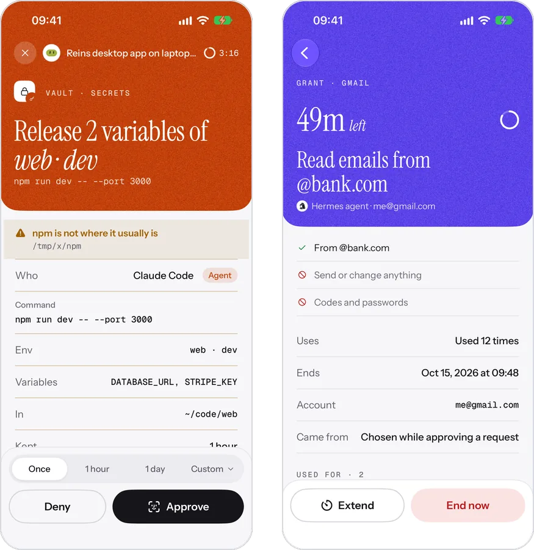
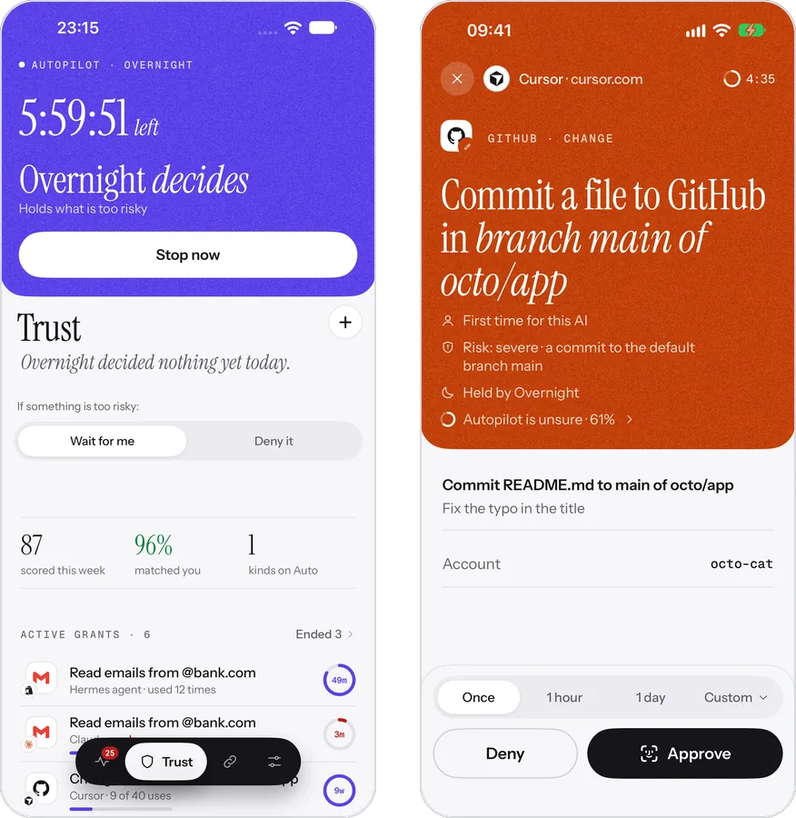
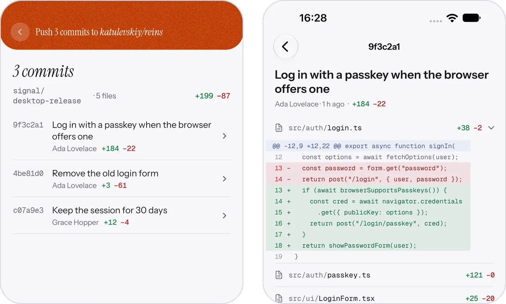
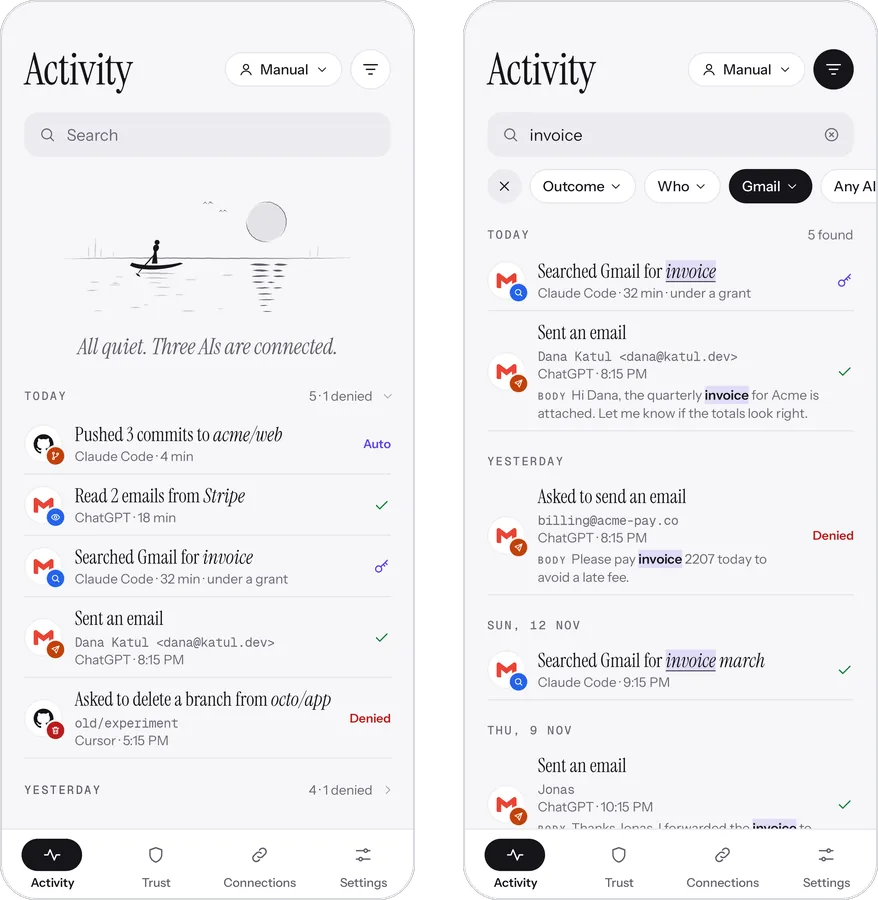
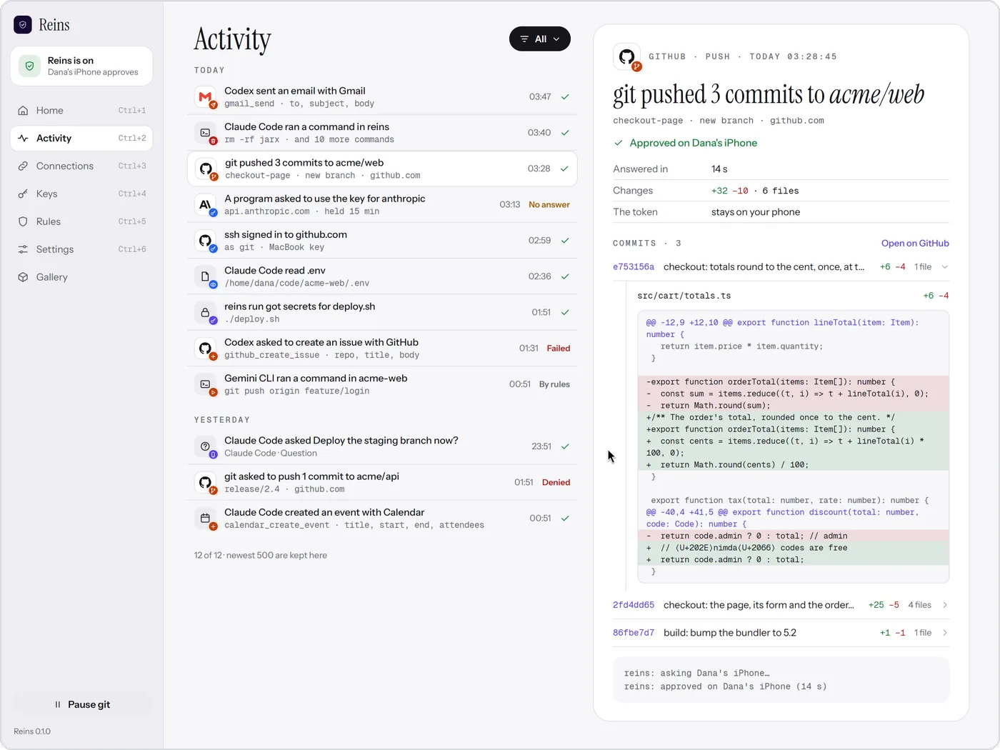
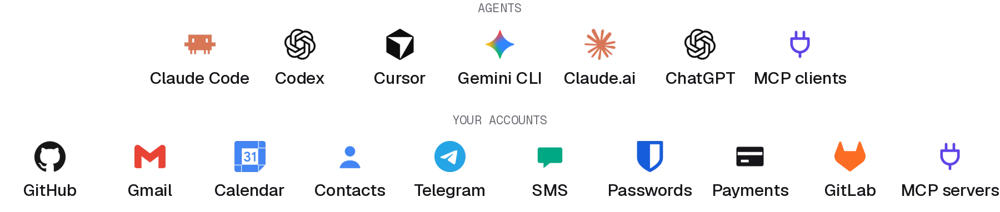
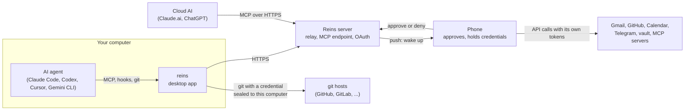

<p align="center"></p>

<h1 align="center">Reins</h1>

<p align="center"><b>Your AI agents ask. Your phone decides.</b></p>

<p align="center">
  Let AI work on your GitHub, your email, your calendar and your terminal.<br>
  Everything that matters shows up on your phone first, exactly as it will happen.<br>
  One tap approves it. One tap stops it.
</p>

<p align="center">
  <picture>
    <source media="(prefers-color-scheme: dark)" srcset="docs/assets/readme/hero-dark.webp">
    
  </picture>
</p>

<p align="center">
  <a href="https://testflight.apple.com/join/2p31yYvf"></a>
  <a href="https://reins2fa.com/download/android"></a>
  <a href="https://reins2fa.com/download/macos"></a>
  <a href="https://reins2fa.com/download/windows"></a>
  <a href="https://reins2fa.com/download/linux"></a>
</p>

<p align="center">
  <a href="https://reins2fa.com"><b>reins2fa.com</b></a>
  &nbsp;·&nbsp; <a href="https://reins2fa.com/developers">For developers</a>
  &nbsp;·&nbsp; <a href="#downloads">Every platform</a>
  &nbsp;·&nbsp; <a href="https://github.com/katulevskiy/reins/releases/latest">Latest release</a>
</p>

<p align="center">Free and open source. In beta.</p>

<p align="center">
  <a href="https://github.com/katulevskiy/reins/actions/workflows/ci.yml"></a>
  <a href="https://github.com/katulevskiy/reins/releases/latest"></a>
  <a href="LICENSING.md"></a>
  <a href="#project-status"></a>
</p>

---

## Why Reins

AI agents are finally useful. They write code, push it, answer email and run commands. To do that, they need your
accounts. Today that usually means handing them everything.

One bad guess later, an agent force-pushes over a week of work, runs `rm -rf` in the wrong place, or sends an email
you never meant to send. An AI can't be held responsible for that. You can, so you should decide.

Reins keeps the power with the agent and the keys with you.

## What it does

### Approve on your phone

The email with its recipients and text. The commits about to be pushed. The command about to run. You see it before
it happens, and answer with Face ID or your fingerprint: once, for an hour, or for a day.

No standing permission covers payments, deletions or history rewrites. Each one asks.

<p align="center"></p>

### Agents never get your keys

Your tokens and passwords stay on your phone. The phone makes the call and hands the agent only the result. There is
nothing for an agent to leak.

Need a secret for a dev server? It's released for that one run. Want an agent to read your bank's emails for an hour?
That's a grant, and it ends on time.

<p align="center"></p>

### Autopilot

A small model on your phone learns what you approve. It answers the routine ones and shows how sure it is. Nothing
you approve leaves the phone to train anything.

- **Manual**: everything waits for you, with a suggestion.
- **Auto**: Autopilot answers what it's sure of. The rest asks.
- **Overnight**: for agents working while you sleep. Risky actions are weighed in context. Anything catastrophic is held.
- **Bypass**: approve everything for a while. Stop is one tap.
- **Lockdown**: every AI stops at once.

<p align="center"></p>

### See every push before it lands

Each commit, each file, each line. Open any push on your phone, before you approve it or long after.

<p align="center"></p>

### Everything in one place

Activity lists what every AI asked for, day by day, and who said yes: you, a grant or Autopilot. Search all of it, and
filter by service, AI or outcome.

<p align="center">
  <picture>
    <source media="(prefers-color-scheme: dark)" srcset="docs/assets/readme/activity-dark.webp">
    
  </picture>
</p>

### A desktop app for coding agents

Reins sits between your coding agent and the outside world. It works with Claude Code, Codex, Cursor and Gemini CLI.

- Risky commands wait for your phone: force pushes, `rm -rf`, `terraform apply`, reading `.env`.
- `git push` goes through Reins. The agent never sees your GitHub token.
- Secrets for a script come from your phone's vault, for that run only.

For Mac, Windows and Linux.

<p align="center">
  <picture>
    <source media="(prefers-color-scheme: dark)" srcset="docs/assets/readme/desktop-dark.webp">
    
  </picture>
</p>

## Works with

<p align="center">
  <picture>
    <source media="(prefers-color-scheme: dark)" srcset="docs/assets/readme/works-with-dark.webp">
    
  </picture>
</p>

Also git on GitLab, Codeberg and Bitbucket, your phone's own calendar and contacts, and any remote MCP server you add
on the phone. Cloud AIs need no desktop app: add `https://app.reins2fa.com/mcp` as a custom connector in Claude.ai or
ChatGPT.

## Get started in 2 minutes

1. **Get the phone app.** [iPhone and iPad](https://testflight.apple.com/join/2p31yYvf) (TestFlight beta) or
   [Android](https://reins2fa.com/download/android) (APK). Tap **Continue** to sign in, and allow notifications.
2. **Install Reins on your computer.** Download it for [Mac](https://reins2fa.com/download/macos),
   [Windows](https://reins2fa.com/download/windows) or [Linux](https://reins2fa.com/download/linux), or in a terminal:

   ```sh
   curl -fsSL https://reins2fa.com/install.sh | sh
   ```

3. **Pair them.** Open Reins on the computer and scan its code with your phone. It finds your AI tools and connects
   them. In a terminal, `reins setup` does the same, and `reins doctor` checks it.

The full walkthrough is in the [quick start](docs/quick-start.md).

## Downloads

| | Get it | Needs |
| --- | --- | --- |
| **iPhone and iPad** | [TestFlight public beta](https://testflight.apple.com/join/2p31yYvf) | iOS 26 |
| **Android** | [APK](https://reins2fa.com/download/android) (updates itself) | Android 12 |
| **macOS** | [.dmg](https://reins2fa.com/download/macos), or `brew install --cask katulevskiy/tap/reins` | Apple silicon or Intel |
| **Windows** | [.msi installer](https://reins2fa.com/download/windows) (x64), or in PowerShell: `irm https://reins2fa.com/install.ps1 \| iex` (x64 and Arm) | Windows 10 or 11 |
| **Linux** | [AppImage](https://reins2fa.com/download/linux) (x86_64), [APT and RPM repositories](docs/linux-packages.md), or `curl -fsSL https://reins2fa.com/install.sh \| sh` (x86_64 and aarch64) | x86_64 or aarch64 |

Every file, with its SHA-256, is on the [latest release](https://github.com/katulevskiy/reins/releases/latest). The
desktop app installs only releases signed with its built-in key, and `reins update` keeps it current.

<details>
<summary><b>Debian, Ubuntu and Fedora packages</b></summary>

The packages `reins` (the command) and `reins-app` (the app) come from signed repositories, so the system keeps them
up to date.

Debian and Ubuntu:

```sh
sudo install -d -m 0755 /etc/apt/keyrings \
  && curl -fsSL https://reins2fa.com/releases/packages/reins.gpg | sudo tee /etc/apt/keyrings/reins.gpg >/dev/null \
  && echo "deb [signed-by=/etc/apt/keyrings/reins.gpg] https://reins2fa.com/releases/packages/apt stable main" | sudo tee /etc/apt/sources.list.d/reins.list \
  && sudo apt update && sudo apt install reins reins-app
```

Fedora:

```sh
sudo curl -fsSL https://reins2fa.com/releases/packages/rpm/reins.repo -o /etc/yum.repos.d/reins.repo \
  && sudo dnf install reins reins-app
```

On Arch Linux, use the install script for now: the `reins-bin` AUR package is not published yet. Details:
[Linux packages](docs/linux-packages.md).

</details>

---

## Under the hood

The rest of this page is for developers: how Reins works, what it protects against, and how to run and build it.

<details>
<summary><b>How it works</b></summary>

<br>



| Part | What it does |
| --- | --- |
| **Phone app** (Android, iPhone and iPad) | Your remote control. Shows each request, approves or denies it, keeps your passwords and tokens, and does the actual work: sends the email, calls GitHub, reads the calendar. |
| **Desktop app** (`reins`) | Sits between the AI agents on your computer and the outside world: it stops risky commands until you approve them, and lets `git push` reach GitHub without the agent ever seeing your token. Works with Claude Code, Codex, Cursor and Gemini CLI. |
| **Server** | A small relay that carries requests from agents (including Claude.ai and ChatGPT in the browser) to your phone and the answers back. It never stores your credentials. Use the hosted one or [run your own](docs/self-hosting.md). |
| **Autopilot** (optional) | An AI model that runs entirely on your phone and learns your decisions. It approves what you'd clearly approve, blocks what you'd clearly block, and asks you about everything else. |

1. An agent asks for something: an MCP tool call (`gmail_send`, `github_pr_merge`, ...), a `git push`, or a risky shell
   command caught by a harness hook.
2. The request goes to the Reins server, which holds it in memory and wakes your phone.
3. The phone shows what would happen. Requests covered by a standing permission you gave earlier run without asking.
4. When you approve, the phone performs the call with its own credentials and returns only the result. For git, the
   phone instead seals a short-lived credential to the desktop app's key; git talks to the host directly and the agent
   never sees the token.

More: [architecture](docs/architecture.md).

</details>

<details>
<summary><b>Every feature</b></summary>

**Approvals on the phone**
- One-time approvals, or standing permissions limited by target, time and number of uses.
- Routine requests in one tap: Approve and Deny on the notification, "Approve and allow for 1 hour" for the same
  thing from the same AI, and Approve all for a burst from one agent run. Each request says what approving does in
  one sentence.
- A starting rule chosen at setup: a new AI asks for everything (recommended), or may see headlines (sender, subject
  and date) for its first hour while opening anything still asks. Codes and passwords are never released without your
  tick.
- Previews of exactly what runs: full emails, git pushes (commits, files, line counts, diffs, force pushes), MCP
  arguments, attached files.
- Approving needs the phone's screen lock or biometrics. Activity on the phone, grouped by day, with search and
  filters.
- Vault secrets an AI asks to see, destructive changes and history rewrites are asked every time. They cannot be
  covered by a standing permission.

**Connectors** (run on the phone)
- Gmail (several accounts), Google Calendar, Google Contacts.
- GitHub: about 200 tools (repositories, files, branches, issues, pull requests, releases, Actions, settings, security
  alerts, gists), plus generic `github_api_read` / `github_api_write`.
- The phone's own calendar, contacts and SMS. Telegram, as your own account.
- The password vault of your account: items, folders, attachments, Sends, the generator. The phone app lists and
  edits it too, and makes SSH keys whose private half never leaves it.
- Payments: an agent asks to buy a cart, you approve it on the phone like a receipt, and it pays with a virtual card
  made for that cart (Privacy.com), a card from your vault, the store's saved payment method, or you pay on the phone.
  Budgets, spend limits, a ledger and a signed mandate of every approval. See [docs/payments.md](docs/payments.md).
- Any remote MCP server you add on the phone. The phone is the MCP client, so its tokens stay on the phone.
- Large files go through one-time upload and download links that the phone controls.

**Desktop app** (`reins`)
- Git proxy for GitHub (and GitLab, Codeberg, Bitbucket when enabled). The agent never holds a git token. Each push
  is analysed from the bytes git sends, and the approval is bound to that exact push.
- Harness hooks that send risky commands and secret files to your phone (force pushes, `rm -r`, `terraform apply`,
  `.env`, private keys, ...).
- `reins ask`: a yes/no question to your phone from any script.
- `reins run`: start a program with API keys released from your vault for that run. `reins vault add NAME` puts a
  key in the vault, typed on the computer and sealed to the phone.
- Local API proxy that adds a vault key to requests. SSH agent whose private keys stay on the phone.
- `reins mcp`: a stdio MCP bridge for local harnesses. `pause`/`resume`, signed self-update.
- Without a phone, a local policy with desktop prompts decides about git instead.

**Autopilot** (optional, on the phone)
- Modes: Manual (you decide, with suggestions), Auto, Overnight, Bypass (time-boxed or until you stop it), Lockdown.
- A small model (Laya, about 370 MB) runs on the phone. It learns from your own decisions in per-profile memory.
- A hard floor that is never automatic in Manual and Auto. Text written by the AI can only make it more cautious.
- See [docs/autopilot.md](docs/autopilot.md).

</details>

<details>
<summary><b>Supported harnesses</b></summary>

<br>

| Harness | MCP server | Hook | Set up with |
|---|---|---|---|
| Claude Code | `~/.claude.json` | `PreToolUse` on Bash, Edit, Write, MultiEdit, NotebookEdit, Read | `reins harness add claude-code` |
| Codex | `~/.codex/config.toml` | `PreToolUse` on Bash, apply_patch | `reins harness add codex` |
| Gemini CLI | `~/.gemini/settings.json` | `BeforeTool` on shell, file write/replace/read | `reins harness add gemini` |
| Cursor | `~/.cursor/mcp.json` | `beforeShellExecution`, `beforeReadFile`, `preToolUse` (Write, Delete) | `reins harness add cursor` |
| Claude.ai, ChatGPT | custom connector `https://<server>/mcp` | none | in the app's connector settings |

Details, the guard rules and how to undo everything: [docs/harnesses.md](docs/harnesses.md).

</details>

<details>
<summary><b>Security model in brief</b></summary>

<br>

- **Credentials stay on the phone.** Gmail, GitHub, Telegram, vault and MCP server tokens are stored encrypted on the
  phone. The server never stores them. One exception: for files too large to pass through a tool call, and for MCP tools
  with very large results, the phone has the server make that one HTTP request with the needed header. The server does
  not keep or log the header.
- **The agent never holds a git token.** The phone seals a short-lived credential to the desktop app's X25519 key. You
  compare that key's fingerprint on the phone and the computer when you pair. The server relays the sealed credential
  but cannot open it. A push credential is bound to the exact push you approved.
- **The server is a relay.** It sees tool arguments and results while they pass through (the AI receives the results
  over the same channel). It keeps them in memory for at most 10 minutes, and keeps large files on disk for at most an
  hour. It stores accounts, AI connections, hashed refresh tokens and a push token.
- **Hooks are guard rails, not a sandbox.** They catch mistakes and obvious risky commands. The hard boundary is that
  the agent has no credentials.
- **Autopilot cannot be talked into approving.** Its approve score is the lower of two passes, one over the facts
  alone and one including the AI's text.

Full threat model: [docs/security-model.md](docs/security-model.md). Report vulnerabilities as described in
[SECURITY.md](SECURITY.md).

</details>

<details>
<summary><b>Autopilot: what it can and cannot do</b></summary>

<br>

Autopilot reads a short text description of each request and answers approve, deny or ask. On held-out synthetic tests
it made no unsafe automatic approvals. It decided about a quarter to a half of requests on its own and asked about the
rest. Those numbers come from **synthetic data**. Wording that no one has tested yet may behave differently. Manual
mode, the default, only suggests. Auto mode unlocks one kind of request at a time,
and only after it has agreed with you often enough. Model card: [tools/laya/MODEL_CARD.md](tools/laya/MODEL_CARD.md).

</details>

<details>
<summary><b>Self-hosting</b></summary>

<br>

The server is a single Rust binary (a fork of Vaultwarden) with SQLite, MySQL or PostgreSQL. Set
`REINS_ENABLED=true` and a public `DOMAIN`, and add a Firebase service account for push. One instance per
deployment, because relay state is in memory. Point the apps at it and nothing passes through the hosted server. See
[docs/self-hosting.md](docs/self-hosting.md).

</details>

<details>
<summary><b>Building from source</b></summary>

<br>

```sh
git clone https://github.com/katulevskiy/reins
cd reins
cargo build --release --features sqlite --bin vaultwarden   # the server
cargo build --release -p reins-desktop                   # the desktop app (target/release/reins)
```

The desktop app also builds on Windows, with the Rust MSVC toolchain (Visual Studio's C++ build tools), as
`target\release\reins.exe`; the release links the C runtime in with `RUSTFLAGS="-C target-feature=+crt-static"`.
Linux and macOS can check the Windows code with `cargo clippy -p reins-desktop --target x86_64-pc-windows-gnu`
(rustup's target and MinGW-w64).

The Android app builds with Gradle from `android/`; the iOS app with Xcode from `ios/` ([ios/README.md](ios/README.md)).
[CONTRIBUTING.md](CONTRIBUTING.md) has the full build and test commands; [docs/self-hosting.md](docs/self-hosting.md)
covers running the server, including with Docker.

</details>

<details>
<summary><b>Repository layout</b></summary>

<br>

| Path | What |
| --- | --- |
| `src/`, `macros/`, `migrations/`, `tests/` | the server: Vaultwarden plus the AI permission relay (`src/api/reins/`) |
| `crates/reins-core` | the phone's core (Rust, through UniFFI): vault, connectors, approvals, Autopilot |
| `crates/reins-desktop` | the desktop app (`reins`): daemon, git/SSH/API proxies, harness hooks |
| `crates/reins-desktop-app` | the Reins app window and tray icon; installers via `scripts/package/` |
| `crates/reins-proto`, `crates/reins-policy` | wire types, and the standing-permission engine |
| `crates/reins-laya` | Autopilot's model on the desktop (ONNX Runtime) |
| `crates/reins-e2e` | end-to-end tests: the real server, phone core and desktop daemon |
| `android/`, `ios/` | the phone apps (Kotlin and Jetpack Compose; Swift and SwiftUI) |
| `tools/laya/` | training and export of the Autopilot model |
| `design/signal/` | the Signal design system: screens, tokens, fonts, icons |
| `docs/` | user guides, the security model, design specs |

Which license covers each part: [LICENSING.md](LICENSING.md).

</details>

## Project status

**Alpha.** Expect rough edges, and breaking changes between releases.

- Phone: Android (Android 12 or later) and iOS / iPadOS 26 or later (iPhone, iPad, iPhone Duo), as a
  [public TestFlight beta](https://testflight.apple.com/join/2p31yYvf); no App Store or Google Play release yet. iOS
  has no text messages integration: apps cannot read SMS there.
- Desktop app: Linux (x86_64, aarch64; also as [.deb and .rpm packages](docs/linux-packages.md)), macOS (Apple
  silicon, Intel) and Windows (x86_64, and Arm when it builds) builds are published with every release. macOS and
  Windows are alpha: built and tested on GitHub's runners, not yet field-tested end to end
  ([macOS](crates/reins-desktop/README.md#macos-alpha), [Windows](crates/reins-desktop/README.md#windows-alpha)).
- Gmail and Google Calendar/Contacts use Google scopes that need Google's app verification before the general public
  can use them.
- Push notifications need an app build that matches the server's Firebase project. With a self-hosted server and the
  published APK, requests arrive only while the app is open.

## Documentation

[docs/README.md](docs/README.md) lists every page: quick start, troubleshooting, harnesses, self-hosting, security
model, Autopilot, architecture. What changed in each release: [reins2fa.com/new](https://reins2fa.com/new).

## Contributing

Issues and pull requests are welcome. [CONTRIBUTING.md](CONTRIBUTING.md) covers building, testing, the commit style
and the [Contributor License Agreement](CLA.md). Please report security issues privately, as described in
[SECURITY.md](SECURITY.md).

## License

Reins uses two licenses:

- **Apache-2.0** (the default, [LICENSE](LICENSE)): the phone apps and their core, the desktop app, the protocol, the
  policy engine, the model tooling and the Autopilot model.
- **AGPL-3.0** ([LICENSE-AGPL](LICENSE-AGPL)): the server, a fork of Vaultwarden.

[LICENSING.md](LICENSING.md) lists which license applies to each part.

## Credits

- [Vaultwarden](https://github.com/dani-garcia/vaultwarden): the server is a fork. Account, vault and sign-in all come
  from it.
- [Laya](https://huggingface.co/convaiinnovations/laya) by Convai Innovations, built on
  [mmBERT](https://huggingface.co/jhu-clsp/mmBERT-base) (JHU CLSP): the base of the Autopilot model.
- Sound design from Zeron.
- Bitwarden, whose client API and web vault the server stays compatible with. Reins is not affiliated with
  Bitwarden, Inc.
- Agent and service marks in the "Works with" image come from [Simple Icons](https://simpleicons.org) (CC0) and the
  Signal design package ([design/signal/assets/logos](design/signal/assets/logos)). They name the products Reins works
  with; Reins is not affiliated with their owners.
