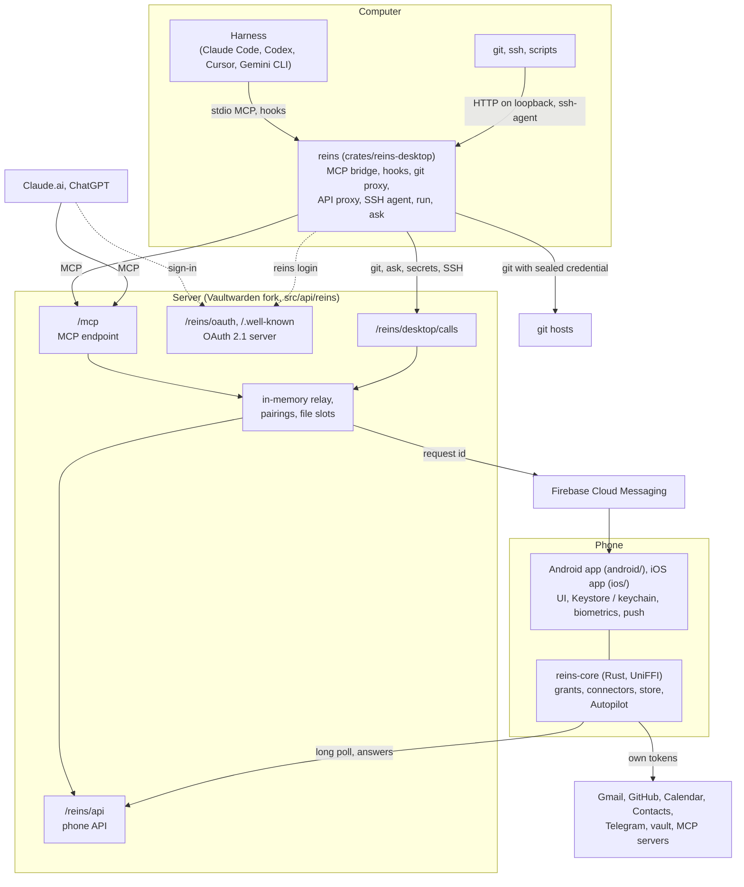
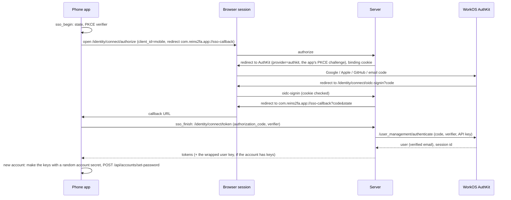
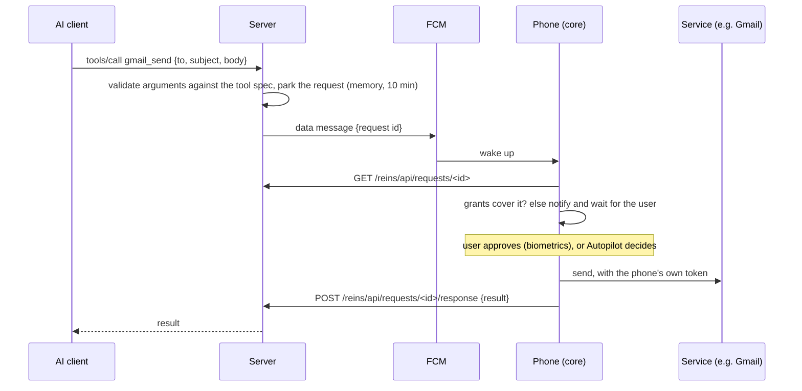
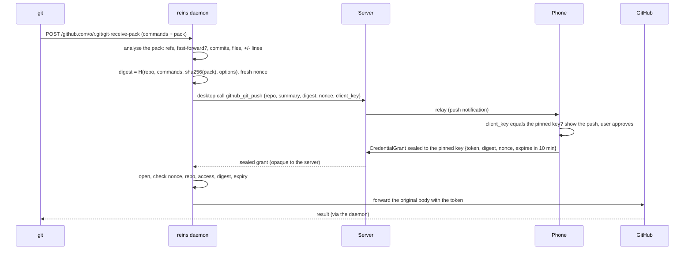

# Architecture

Reins has three parts that run on different machines. The phone decides and holds the credentials. The server
relays. The desktop app is the local hub for agents on a computer.

## Components

| Component | Where | Language | What it does |
|---|---|---|---|
| Server | `src/` (Vaultwarden fork), Reins code in `src/api/reins/` | Rust (Rocket, Diesel) | Accounts and vault (Vaultwarden), MCP endpoint, OAuth 2.1 authorization server, relay, phone API, desktop API, file slots, FCM and APNs senders |
| Protocol | `crates/reins-proto` | Rust, no IO | Wire types shared by server, phone and desktop: tool specs and argument validation, relay requests and results, pairing, desktop tools, sealed payloads, file slots, MCP server reports |
| Policy | `crates/reins-policy` | Rust, no IO | Grants and their evaluation: scopes, patterns, expiry, uses |
| Phone core | `crates/reins-core` | Rust, exported to Kotlin with UniFFI | Request handling, connectors (Gmail, Google, GitHub, git hosts, Telegram, device data, vault, remote MCP, desktop tools), encrypted SQLite store, audit log, Autopilot |
| Android app | `android/` | Kotlin, Jetpack Compose | UI, Android Keystore (wraps the core's data key), biometrics, Google Play services tokens, FCM, WorkManager, ONNX Runtime for Autopilot |
| iOS app | `ios/` | Swift, SwiftUI | UI, keychain (wraps the core's data key), Face ID, Google OAuth tokens, APNs and a notification service extension, widgets and Live Activities, ONNX Runtime for Autopilot |
| Desktop app | `crates/reins-desktop` | Rust | The `reins` CLI and daemon |
| Model runtime for tools | `crates/reins-laya` | Rust (`ort`) | Runs the Autopilot model on desktop CPUs for tests and `laya-try`. Not part of the phone. |
| Model tooling | `tools/laya` | Python | Synthetic data, fine-tuning, ONNX export, evaluation |
| End-to-end tests | `crates/reins-e2e` | Rust | Real server + real phone core + desktop app, with fake services |

## Server endpoints

| Path | Who calls it | Auth |
|---|---|---|
| `POST /mcp` | AI clients, `reins mcp` | OAuth bearer token (1 h JWT) |
| `/.well-known/oauth-authorization-server`, `/.well-known/oauth-protected-resource[/mcp]` | AI clients | none |
| `/reins/oauth/register`, `/authorize`, `/token` | AI clients, `reins login` | PKCE S256; public clients (dynamic registration or client ID metadata document), or `private_key_jwt` clients (RFC 7523; metadata document with `jwks_uri` or `jwks`, as ChatGPT uses) |
| `POST /reins/oauth/device_authorization` | `reins login` (QR code) | public clients; RFC 8628, polled at `/token` |
| `GET /pair?code=` | a phone that scanned a computer's QR code without the app | none; opens the app or offers it |
| `/.well-known/apple-app-site-association`, `/.well-known/assetlinks.json` | iOS, Android | none; pairing links open the app (`REINS_APPLE_TEAM_ID`, `REINS_ANDROID_CERT_SHA256`) |
| `/.well-known/openai-apps-challenge` | OpenAI's directory review | none; the domain verification token (`REINS_OPENAI_APPS_CHALLENGE`), 404 when unset |
| `POST /reins/desktop/calls`, `GET /reins/desktop/calls/<id>` | desktop app | the same OAuth token as MCP; only desktop-only tools |
| `/reins/api/*` (`device`, `pending`, `requests`, `pairings`, `pairings/claim`, `connections`, `services`, `blobs`, `mcp/call`) | the phone | Vaultwarden login token, and the caller must be the account's approval device |
| `POST /reins/api/joins`, `GET /reins/api/joins/<id>` | a phone of the account that cannot open its keys | Vaultwarden login token (any device of the account but the approval device) |
| `POST /reins/api/account/delete` | the phone apps' Settings → Delete account | Vaultwarden login token issued in the last 5 minutes, the typed account email, and the approval device (or, from another device, the master password hash); see [security model](security-model.md#accounts-without-a-master-password) |
| `GET /reins/api/joins/<id>`, `POST /reins/api/joins/<id>/response` | the approval device | as the rest of `/reins/api/*` |
| `POST /reins/api/joins/<id>/challenge`, `POST /reins/api/joins/<id>/reveal` | the approval device, then the phone enrolling as a viewer | as above, for each side; once each, in that order ([phone roles](#phone-roles-and-live-sync)) |
| `GET /reins/api/roster` | any phone of the account | Vaultwarden login token; an empty list until the account has a roster (404: a server without phone roles) |
| `POST /reins/api/roster`, `GET`/`DELETE /reins/api/handover-bundle`, `PUT /reins/api/checkpoint`, `POST /reins/api/heartbeat` | the primary (a recovery: the phone it makes primary) | the roster's primary with its enrolled device key, plus the owner key's or primary's signature; a recovery brings the master password hash |
| `POST /reins/api/roster/recovery-wrap` | a phone about to recover | Vaultwarden login token and the master password hash (counted like takeover proofs) |
| `GET /reins/api/sync`, `POST /reins/api/ops`, `POST /reins/api/ack`, `GET /reins/api/checkpoint`, `PUT /reins/api/member`, `POST /reins/api/handovers`, `GET /reins/api/connections` | roster members (the primary and viewers) | Vaultwarden login token and the device key the member enrolled with; ops are checked against the roster and their author's signature |
| `PUT`/`POST`/`GET /reins/blob/<secret>` | whoever holds the link (AI, curl) | the unguessable link itself, single-purpose, expiring |
| `/identity/connect/authorize`, `/identity/connect/oidc-signin`, `/identity/connect/token` (`authorization_code`) | the phone apps' "Continue", through the browser | SSO (WorkOS AuthKit on the hosted server), PKCE S256 end to end |
| `POST /reins/workos/webhook` | WorkOS | `WorkOS-Signature` (HMAC-SHA256); only wakes the WorkOS syncs (users, directories) |
| `GET /reins/api/org`, `POST /reins/api/org/enroll/challenge`, `POST /reins/api/org/devices`, `PUT /reins/api/org/posture` | a work profile's phone | Vaultwarden login token of an org's active member (404 for anyone else); enrollment proves the device key with a signature over a single-use challenge |
| `GET /reins/api/org/reviews`, `POST /reins/api/org/reviews/<id>`, `PUT /reins/api/org/member-policy` | a work profile's phone | as above; answers and member policies are signed by the enrolled device key, which must pass the org's posture rule |
| `POST /reins/api/org/leases`, `GET /reins/api/org/leases/<id>` | a work account's desktop daemon | its connection's bearer token; the credential comes back sealed to the daemon's X25519 key |
| `/reins/org-exec/…` (`claim`, `keys`, `policy/<hash>`, `roster`, `rollouts`, `receipt`, `revocations`, `revoked/<id>`) | an org executor | every call signed with the executor's registered Ed25519 key over (org, executor, method, path, time, body hash), ±120 s; one tenant per executor |
| `/reins/org-exec/connect/claim`, `/reins/org-exec/connect/done` | a family's executor (P7) | as the rest of `/reins/org-exec/…`; a finishing job carries the provider's one-time code once, and the answer names the account, never a token |
| `POST /reins/api/org/family/join`, `GET /reins/api/org/family`, `POST`/`DELETE /reins/api/org/family/leave`, `POST /reins/api/org/family/leaves/<member>/consent`, `POST /reins/api/org/family/minor`, `POST /reins/api/org/family/members/<member>/minor`, `POST /reins/api/org/family/invites` | a family profile's phone (P7) | Vaultwarden login token; a join needs a new account and an invitation for its exact email; the rest need an active member of the family (guardians for consent, marks and invites) |
| `GET /reins/org/family/oauth/callback` | a guardian's browser, back from Google or GitHub | the guardian's console session that began the connection, and the executor's `state` |
| `POST /reins/org/github/policy-webhook` | the org's GitHub reader App | `X-Hub-Signature-256` (HMAC-SHA256 with the org's sealed webhook secret), the org's installation and bound repo only, each delivery once; a merge only proposes an activation |
| `/mcp` of a work account | its agents | as for any account; the call goes to the org's decision service instead of the relay |
| `/reins/org`, `/reins/org/<org>/…` | org admins, in a browser | the admin console: SSO through `/identity/connect/authorize` (`client_id=reins-console`), an in-memory session and a CSRF token per form; every page re-reads the admin's roles |

Persistent tables: `reins_devices` (the approval device and its push token), `reins_clients` (registered OAuth
clients), `reins_connections` (authorized AIs and desktop apps), `reins_refresh_tokens` (SHA-256 hashed),
`reins_sso_sessions` (the WorkOS session each device signed in with), `reins_settings` (the WorkOS events
cursor), and for phone roles `reins_rosters` (the owner-signed roster chain, the recovery wrap and a handover's sealed
bundle), `reins_members` (each listed phone's role, signing key, enrolled device key, push token, op counter,
acknowledged `seq` and, for the primary, its latest heartbeat), `reins_ops` (signed, sealed ops) and
`reins_checkpoints` (the primary's latest two sealed snapshots). Organizations (`REINS_ORGS_ENABLED`) build on
Vaultwarden's `organizations`, `users_organizations` and `groups` and add `reins_orgs` (tier, sign-in binding),
`reins_org_domains` and `reins_org_verified_domains`, `reins_org_members` (each member's state in its org: the
org-side authority), `reins_org_roles`, `reins_org_changes` (two-person admin changes), `reins_org_devices`
(enrolled devices, attestations, posture) and `reins_org_events` (the org's hash-chained audit log). O2 adds
`reins_org_keys` (per-tenant keys, sealed), `reins_org_policies` and `reins_org_member_policies`, `reins_org_requests`
(decisions, their trace and countersigned record), `reins_org_bodies` (sealed bodies, results and receipts, with
retention), `reins_org_approvals` (device-signed answers), `reins_org_executors`, `reins_org_leases` and
`reins_org_checkpoints`. O3 adds `reins_org_people` (managers, linked GitHub, Slack and Teams identities),
`reins_org_group_settings` (backups, windows), `reins_org_oncall`, `reins_org_channels` (sealed Slack and Teams apps),
`reins_org_github_reader` (shared with O4), `reins_org_steps` (each obligation's escalation steps),
`reins_org_web_passkeys`, `reins_org_web_tokens` (one-time web approval links, as SHA-256) and `reins_org_posted`
(channel messages to update), and `reins_org_requests.resolved`. O4 adds `reins_org_policy_repo`,
`reins_org_simulations` (reports by hash), `reins_org_rollouts` (every step pre-signed) and
`reins_org_webhook_deliveries`, and keeps each request's body-free analysis and rollout step on `reins_org_requests`.
O5 adds `reins_org_audit_sinks` (sealed streaming destinations and how far each was delivered) and
`reins_org_witness` (RFC 3161 timestamps of checkpoints); the audit routes are under `/reins/org/<org>/audit/`
(`export`, `report`, `keys.json`, `checkpoints/<seq>.json|tsr`, `streaming`).
Deferred decisions add `reins_tickets`, `reins_ticket_events`, `reins_device_keys` and
`reins_callbacks`, and Circles `reins_circle_invites`, `reins_circle_links` and `reins_circle_packets`; guardianship adds
`reins_circle_changes` (each signed change and when it arrived) and `reins_guardian_notices`. The Family tenant (P7) adds
`reins_families` (the notice), `reins_family_invites` (hashed secrets, bound to an email), `reins_family_members`
(minors, and a guardian's pending proposal), `reins_family_leaves`, `reins_family_connections` (which provider is
connected for whom) and `reins_family_connect_jobs` (the executor's connect, finish and revoke jobs). Everything else is in memory with a time limit, so
there is one server process per deployment.

## Flows

### Signing in without a password

A second phone finds the keys locked and gets the secret from the approval device ("Add another phone": an X25519 key,
a six-digit code compared on both screens, the secret sealed to the key and relayed by the server) or from the recovery
code. Either is also what lets it take the approval role from the first phone: the server wants that approval, or the
master password hash of the secret, before another device approves
([security-model.md](security-model.md#which-device-approves)). The server follows WorkOS in the background
(`src/api/reins/workos_sync.rs`): verified email changes, deleted users, revoked sessions. See
[security-model.md](security-model.md#accounts-without-a-master-password).

### A tool call from an AI

If the phone has not fetched the request within `REINS_OFFLINE_SECS`, the AI is told the device is offline. When
nothing can wake the phone (no push token, push not configured, or the push service refused) and its app has not
polled in the last 10 seconds, it is told at once instead. The message says when the phone was last heard from ("last
seen 2 hours ago") and that the request waits up to 10 minutes. If nobody decided within `REINS_RELAY_WAIT_SECS`, it
is told to call `reins_get_result` later. The request stays answerable for 10 minutes, and a late answer is kept for
`reins_get_result`. The same call from the same connection while the first is still unanswered (a client retrying
after a timeout) is that first request: the phone shows it once and both callers get its answer. The desktop app
sends how long it keeps asking (`X-Reins-Wait`, for `reins ask`, hooks and git): the phone counts that down instead
of one relay wait, up to the 10 minutes.

For reads, the phone runs the search itself and checks each result against the grants. The AI's query is only a
prefilter, so query syntax cannot widen what a grant allows.

### Deferred decisions (tickets)

A request nobody answers within its **Instant window** (`REINS_INSTANT_WINDOW_SECS`, default 2 min, at most 10)
becomes a **ticket**, and the agent gets it at once instead of waiting:
`{"status": "pending_review", "ticket": "rt_…", "expected_by": …, "next": …}`. This is not an error. The same happens
when the agent asks for it (`_meta["dev.reins/defer"]` on `tools/call`, or `X-Reins-Defer: 1`; `reins ask --defer`),
or when the reviewer taps **Later**. A ticket waits for its **Deferred window** (`REINS_DEFERRED_WINDOW_SECS`,
default 4 h, at most 7 days). Phones from before tickets publish no box key; their requests stay Instant and expire
after 10 minutes as before.

- **Storage:**
  - `reins_tickets` keeps metadata in clear: the ticket, its state, its deadlines, the connection and the request
    digest (SHA-256 over the connection, the account and the call).
  - The request itself is sealed on the server to the approval device's X25519 box key (`reins_device_keys`, published
    with `PUT /reins/api/device`), and the clear copy is dropped.
  - An agent's answer to a "Why?" is sealed the same way.
- **Transitions** (`reins_proto::ticket::TicketState`) are recorded in `reins_ticket_events`:
  - the phone's are signed with its Ed25519 device key and checked by the server against the key the device published;
  - the server's own transitions (deferral, expiry, a cancellation, an agent's reply) are marked unsigned.
- **Who runs it** (08 R9):
  - **Writes** run on the phone when approved. Only a minimal result (ids, a status, a link) is kept for the agent.
  - **Reads and desktop answers** are only approved. They run when the agent collects them (`reins_get_result`,
    `reins_wait`, `GET /reins/desktop/calls/rt_…`): the phone runs the read again, releases only the items the owner
    picked, and the result passes through memory to the waiting agent. A collect uses the approval once.
  - Before anything runs, the phone revalidates: the request must be exactly the one approved (its digest), within its
    window.
- **Tools:** `reins_get_result` (a ticket or a request id), `reins_wait` (up to 10 minutes), `reins_cancel`,
  `reins_tickets`, and `reins_reply` (answers a reviewer's "Why?").
- **MCP resources:** tickets are also resources (`reins://tickets/rt_…`). A client that subscribes gets
  `notifications/resources/updated` on `GET /mcp` with `Accept: text/event-stream`.
- **Webhooks:** a connection can register an https callback (`PUT /reins/agent/callback`), after it echoes a
  challenge.
  - Reins POSTs only events the approval device signed (`ticket.approved`, `.denied`, `.expired`, `.stale`, `.done`),
    with `Reins-Signature` and `Reins-Key`.
  - A server can delay or drop them, but not forge an approval.
- **Ordering and races:**
  - The phone posts its signed approval first, and runs a write only once the server accepted it (the ticket was not
    cancelled, expired or made stale meanwhile).
  - A request the phone has already fetched is never parked behind its back. It becomes a ticket only by the phone's
    own signed Later, or by the phone itself when the Instant window passes. It can't be withdrawn once fetched.
  - The phone re-reads the open tickets on every sync, so one delivered while it couldn't keep it is not lost.
  - An approved read's result waits five minutes for its agent. The ticket is done only once an agent received it,
    and a parked push once the desktop app reports it pushed.
- **Limits:** at most 50 open tickets per connection, and an identical call returns its open ticket. On the desktop,
  pushes to one ref run in ticket order.
- **Keys:**
  - With phone roles, tickets are sealed to and checked against the roster primary's keys.
  - A new approval phone closes the tickets sealed to the old one.
  - The phone shows its signing key as twelve digits under a connection's More. Agents and the desktop app pin the key
    and refuse a changed one until the user compares.
- **Desktop:**
  - A parked hook answers the agent with `Parked for review (ticket …)`. Later hook calls of the same session carry the
    news.
  - An approved command passes the hook once, bound to the digest of the exact raw call, for an hour.
  - A parked `git push` is kept and pushed on approval, only if every ref is still where git found it; otherwise the
    ticket is Stale. `reins tickets` and `reins wait` cover scripts.

### Circles (shared control)

Another Reins account reviews this one's requests within a scope (04): a delegate, a co-signer, a guardian or a
watcher. `reins_proto::circle` holds the messages and checks, `reins_policy::circles` the obligations and how votes
settle, `reins-core/src/circles` the phone side and `src/api/reins/circles.rs` the routes.

- **Invitation** (`/reins/api/circles/invites*`, `…/join`): the owner posts a commitment and gets a one-time
  `reins-circle://<server>/<secret>` link; the helper answers with its owner key and a nonce (binding it); the owner
  reveals and sends the terms sealed to the helper's approval phone; both phones show six digits; the helper signs,
  the owner confirms (hold and biometric) and activates. `reins_circle_links` then holds the routing and each side's
  sealed copy.
- **A request in scope:** when the owner's phone parks it, it computes a **hold** (no network), so Autopilot only
  waits on it. Review packets (signed, sealed to each helper's approval phone) go to `reins_circle_packets`; the helper
  is pushed (`PushKind::Circle`, `review:<id>`: the one Circle notification). A Deferred arrangement makes the request
  a ticket at once.
- **Answers:** the helper's phone signs and seals its answer; the owner's phone takes it on its next sync or push,
  verifies it, and settles the hold: either deny wins; once everyone needed approved (the owner's tap included where
  it is needed), it runs through the owner's own approval path. Windows that run out deny, or leave a delegate's
  request to the owner.
- **Changes:** pause, resume and end are signed changes (`…/links/<id>/change`); ending drops a delegate's or
  co-signer's part of what waits and lapses a guardian's.
- **Receipts:** the owner's Activity names who decided ("Approved by …"); the helper's keeps "Approved for …".
- **Guardianship** (P7, `reins-core/src/circles/guardian.rs`, `src/api/reins/guardian_notices.rs`): the ward's end is
  a signed `EndRequested` that keeps the link until `effective_at` (the Circle sweep then ends it); a minor's waits for
  the guardian's `EndConsented`. Every change is logged with its arrival time and returned in `GET …/circles/links`
  (`changes`), so the guardian's phone checks each step against its own terms. The server writes guardian notices
  for a reset, a deletion (before the rows go), roster changes and the ward's changes; `GET /reins/api/guardian/notices`
  returns them until `POST …/notices/seen` acknowledges them, and one that needs the guardian pushes `alert:<link>`.
  A link keeps at most 200 changes. The ward opts in to a weekly digest (one
  Notice packet after Monday 09:00 UTC).

### Pairing an AI or the desktop app

1. The client registers (dynamic registration, or a client ID metadata document URL) and opens
   `/reins/oauth/authorize` with PKCE. The desktop app adds `reins_client_key=<X25519 public key>`.
2. The user enters their email. The page shows a two-digit code (and the desktop key's fingerprint). The phone gets a
   pairing request.
3. The user taps the matching code among three, names the connection, and confirms with biometrics. For the desktop
   app, the phone pins the key to the new connection.
4. The page redirects with an authorization code. The client exchanges it for an access token (1 h) and a rotating
   refresh token (30 days). A client whose metadata document declares `private_key_jwt` (ChatGPT) signs a client
   assertion for the exchange and for every refresh: RS256, PS256, ES256 or EdDSA, verified against its JWKS (cached
   5 minutes, fetched again once for an unknown `kid`), `iss` = `sub` = `client_id`, `aud` the token endpoint or the
   issuer, at most 5 minutes of lifetime, and a `jti` that is accepted once. The method is bound to the code and stored
   with each refresh token, and a client once seen with `private_key_jwt` (document or grant) is recorded and never
   accepted without an assertion again; anything that cannot be determined refuses the request. A client whose
   document or key set the server holds is served from it, and up to 10 minutes past its freshness from the last good
   copy while it is refreshed in the background (a refetch that no longer lists a key drops it at once). Refreshes
   have a reserved pool (4, one per site), are spaced 5 s per document with back-off after failures (at most a
   minute; failures neither stop them nor extend the grace) and are limited per requesting address. Other fetches
   are charged to the requesting address (IPv6: its /64; 20, then one per 3 s), run once per URL at a time, at most 2
   per site (registrable domain under its ICANN public suffix, by the Public Suffix List) and 32
   in all, queue at most 2 s, take at most 4 s, and hold no database connection; only failures that do not depend on
   timing are remembered (30 s, per kind and exact URL). Documents and key sets must be named by a domain, never an
   IP address. Dynamic registration stays public-only.

`reins login` pairs without a browser by default (OAuth device authorization, RFC 8628):

1. The app asks `/reins/oauth/device_authorization` for a code, with its key. It shows a QR code of
   `https://<server>/pair?code=BCDF-GHJK`, the code itself, a two-digit number and its key's fingerprint.
2. The phone scans the QR code (the camera opens the link in the app; the app's own scanner reads it), and claims the
   code (`POST /reins/api/pairings/claim`). That starts an ordinary pairing for the phone's account, with the
   computer's number among the three choices.
3. The user taps that number, compares the key and confirms with biometrics, as above. The phone pins the key.
4. The app polls `/reins/oauth/token` (grant type `urn:ietf:params:oauth:grant-type:device_code`) and gets the same
   tokens. Codes live 10 minutes, in memory.

### A git push through the desktop app

A clone or fetch first tries without credentials, since public repositories need no approval. Then it asks for a read
credential, which is valid for 1 hour and cached per repository. A refused push is answered in git's own protocol, so
git prints `! [remote rejected] main -> main (...)`. Pack data flows between the computer and the git host only. The
phone sees only the summary.

### Other desktop tools

`reins ask` (`desktop_ask`), `reins run` and the API proxy (`vault_secret_release`), the SSH agent
(`vault_ssh_keys`, `vault_ssh_sign`) and `reins vault add`/`list` (`vault_phone_key`, `vault_secret_store`,
`vault_names`) use the same path. Each answer is sealed to the pinned key and echoes the
request's nonce. GitLab, Codeberg and Bitbucket use `<service>_git_fetch`, `_push` and `_tag_push`. Their pushes are
analysed from the pack alone, without the host's API.

### Large files

A tool result over 256 KiB, or a file an AI needs to pass to a tool, goes through a file slot on the server:

- **AI to tool:** the phone opens an upload slot and answers with an upload link (`curl -T file <link>`). When the file
  arrives, the phone shows its name, size, type and a preview. If you approve, the phone has the server send it to its
  destination (GitHub) or downloads it to encrypt it into the vault.
- **Service to AI:** the phone has the server fetch the large result (or uploads what it produced itself) and gives
  the AI a download link.

Slots hold at most 1 GiB per file. Each file is deleted when its operation is done, or within an hour at the latest.

### Remote MCP servers

You add MCP servers on the phone. The phone is the MCP client, and their tokens stay on it. The phone reports each
server's id, name and tool list to the server, which lists them to AIs as `<server>__<tool>`. A call is relayed to
the phone like any other. Tools the server marks read-only are reads, and all others are writes. Destructive tools
are asked every time. When a tool's results are very large, later calls to it go through the server
(`/reins/api/mcp/call`), so large items can be replaced with download links.

### Phone roles and live sync

Server side of the phone roles design (`reins-designs/phone-roles/phone-roles-and-live-sync.md`; wire types in
`reins_proto::roster`, `oplog`, `answer`, `enroll`; server in `src/api/reins/roles.rs` and `live.rs`). One phone is
the **primary**: it is the approval device and decides. The account's other enrolled phones are **viewers**: they see
everything live and decide nothing. An account without a roster works exactly as before; the apps detect the feature
with `GET /reins/api/roster` (404: an older server).

1. **Create.** The approval device appends roster epoch 1, signed by a new owner key, with the recovery wrap.
2. **Enroll.** A phone posts a join with its signing and box keys and a commitment to a nonce. The primary posts a
   challenge (its nonce and keys), the phone reveals its nonce, both show six digits over the whole exchange, and the
   primary appends an `enroll` entry. The server lists the phone only with the device key that asked.
3. **Live.** Members post signed ops (`POST /reins/api/ops`); the server checks each against the roster (author's
   role, class, epoch, signature, rising counter, size) and numbers them. Viewers long-poll `GET /reins/api/sync`
   (ops, the epoch, the primary's heartbeat, and the requests, pairings and joins waiting for the primary, which a
   viewer's look never marks delivered); the primary sees new ops through `GET /pending` (`log_head`, `log=`). Pushes
   are `sync` (silent, or an alert when an op asks) and `handover`. The primary writes checkpoints; the server keeps
   two and drops the ops up to the older. Members acknowledge what they applied (tombstone GC).
4. **Handover.** A viewer asks (`POST /reins/api/handovers`); the primary appends a `handover` entry with the sealed
   bundle. The approval role moves at once, unanswered requests, pairings and joins go to the new primary, and the
   old one gets `replaced`.
5. **Recovery.** A viewer or a fresh phone appends a `recovery` entry signed with the old owner key (from the recovery
   wrap) introducing a new one, with the master password hash; the role moves the same way.

Once the account has a roster, the approval device is the roster's primary (with its enrolled device key), answers
to requests, pairings and joins are `SignedAnswer`s verified against its key, `PUT /account-state` answers 410 (reads
still work for older apps), and `PUT /device` registers only the roster's primary. A changed master password is a
`rewrap` entry carrying the new recovery wrap.

### Autopilot

After the core parks a new request, it runs Autopilot's pass: mode, hard floor, then (Manual or Auto) the model on
two views of the situation, memory, adapter, gates, decision. It approves or denies through the same code the user's
taps use, or attaches a suggestion and notifies the user. See [autopilot.md](autopilot.md).

## Design documents

The design specs under `docs/superpowers/specs/` record the detailed contracts and the reasoning behind them:

- `2026-09-28-reins-mvp-design.md`: the server, relay, OAuth, phone core and policy.
- `2026-09-29-reins-contracts.md`: wire contracts.
- `2026-09-30-desktop-git-proxy.md`: the desktop app and git.
- `2026-09-30-github-vault-tools.md`: the GitHub and vault tools.
- `2026-10-01-files-mcp-daemon.md`: large files, remote MCP, and the desktop app's other parts.
- `2026-10-01-autopilot-laya.md`: Autopilot.
- `2026-10-02-passwordless-sign-in.md`: sign-in through WorkOS AuthKit, the keyless vault, another phone, the WorkOS
  sync.
