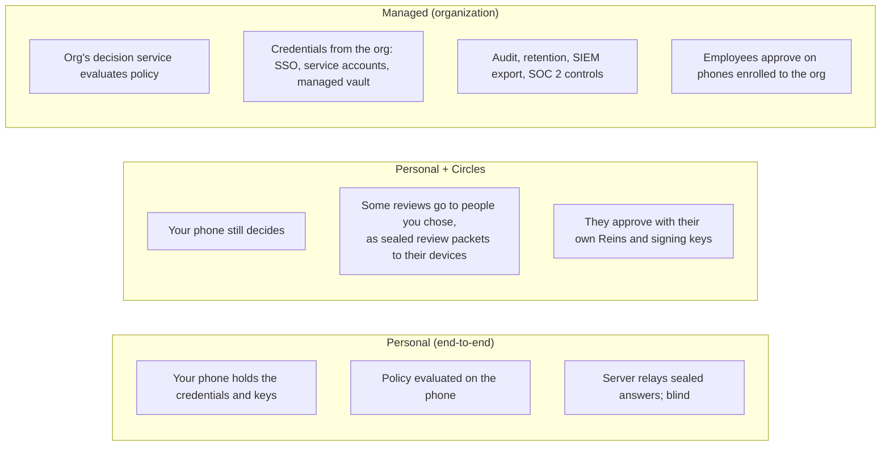

# Reins Decisions v2: overview

**Status:** proposed architecture, 2026-10-26. It supersedes the direction proposal in
`docs/superpowers/specs/2026-10-26-auto-v2-design.md`, whose measurements (§1 there) it keeps.

Reins started as a security app: an AI asks, your phone decides. To become a great app, it has to decide **almost
everything itself, correctly**, and bring a human in only where a human adds judgement. It also has to work for one
person, for people who look after each other, and for companies that must prove who allowed what.

This set of documents describes that system:

| # | Document | What it decides |
|---|---|---|
| 00 | Overview (this) | vision, vocabulary, the three trust modes, the calls already made |
| 01 | [Decision engine](01-decision-engine.md) | how a request becomes Auto or Ask: consequence engine, context graph, policy matrix, safety nets, model, learning, Overnight |
| 02 | [Policy and authority](02-policy-and-authority.md) | one policy model for personal rules, repo rules, shared control and organizations; precedence; explainability |
| 03 | [Decision lifecycle and async](03-decision-lifecycle.md) | instant versus deferred decisions, the request state machine, the agent protocol for non-blocking asks, expiry, revalidation |
| 04 | [Shared control](04-shared-control.md) | delegating to a friend, dual confirmation, guardians, a manager's sign-off, between Reins users |
| 05 | [Organizations](05-organizations.md) | Reins for companies: SSO and SCIM, roles (CISO, approver groups, auditors), managed connections, device enrollment, policy rollout |
| 06 | [Trust modes, security and compliance](06-trust-and-compliance.md) | Personal (end-to-end encrypted) versus Managed (compliance-grade, SOC 2), what each server can see, audit, threat models |
| 07 | [Roadmap](07-roadmap.md) | phases, migration from today's Autopilot and authorization runtime, success metrics |
| 08 | [Review resolutions](08-review-resolutions.md) | answers to the builder review; **wins over 00–07 where they disagree** |

## The problem in numbers

From this computer's own Reins history (13–26 Oct, 781 requests; detail in the proposal):

- about **100 requests a day** from coding agents, **94%** approved by hand, **0.4%** denied, and **5%** left to time
  out;
- the keyword guard flagged "reads your keys" **45** times, and **44** of those were false (code that only *mentions*
  `.ssh`);
- about **20 of 781** requests were worth a human look.

Target: **about 2 asks a day** for that workload, with every real risk still asked, and none of them a raw command.

## Principles

1. **Auto approves or asks; it never denies.** Only explicit rules deny: Lockdown, a "never" rule, an organization's
   mandatory policy.
2. **Judge consequences, not text.** Every request is turned into typed effects (files, git refs, people, money,
   secrets, publication, permissions), with a consequence level from *undoable* to *irreversible*.
3. **Context is first-class: whose is it.** Mine, Friends, Work or Outside, for every repo, path, account and person,
   from facts Reins can verify.
4. **Humans decide what humans are good at:** people, money, publishing, permissions and irreversible loss. Never what
   a shell command does.
5. **Make things reversible, then automate them:** backup refs, a trash for deletes, a hold with Undo on sends.
6. **Decisions take the time they need.** Instant ones block briefly; deferred ones don't block the agent at all, and
   can wait hours.
7. **Authority is explicit and layered.** Personal rules, repo rules, people you share control with, and your employer
   each have a defined place, and stricter always beats looser.
8. **Two trust modes, one product.** Personal is end-to-end encrypted, and the server is blind and can't decide.
   Managed (for organizations) is compliance-grade: central policy, audit and provisioning, with the employer
   accountable instead of the phone.

## Vocabulary

| Term | Meaning |
|---|---|
| **Request** | one thing an agent wants to do: a tool call, command, push, send, purchase or secret release |
| **Effect** | a typed consequence of a request (delete 3 files in the workspace; send to 2 people; push rewriting history) |
| **Level** | the worst effect's consequence: **L0** undoable, **L1** recoverable, **L2** reaches people, **L3** irreversible or far-reaching |
| **Zone** | whose a thing is: **Mine**, **Friends**, **Work**, **Outside** (organizations add their own, e.g. *Production*) |
| **Policy** | a rule from any source (you, a repo, a person you share with, your org): permit, review, deny, park |
| **Decision** | the outcome for one request: **Auto** (approved by policy), **Ask** (needs a person), **Deny** (explicit rule only) |
| **Review** | the human part of a decision: who must approve (one person, any of a group, N of M, a specific role), and by when |
| **Instant decision** | a review the agent waits for (seconds to a few minutes) |
| **Deferred decision** | a review the agent doesn't wait for: it gets a ticket, carries on, and is told the outcome later |
| **Task** | an approved envelope of work: "fix CI in dkat/reins, 2 h, fix/* branches, no email". Inside it, matching requests are Auto. Called a *mission* in the proposal. |
| **Safety net** | something Reins does first to make a request recoverable (backup ref, trash, send hold) |
| **Circle** | people you share control with (Personal mode): a friend, family, a co-founder |
| **Organization** | a company tenant (Managed mode): members, roles, managed connections, policies, audit |
| **Approval device** | the phone that decides for a personal account (today's primary in the roster) |
| **Decision service** | the component that evaluates policy and records decisions: on the phone in Personal mode, in the organization's Reins deployment in Managed mode |

## The three trust modes at a glance

A person can have both: their own Personal account, and a Managed work profile from their employer, on the same phone
(§06). Each request belongs to exactly one, decided by which credential it uses (work GitHub org through the org's
connection → Managed; your own Gmail → Personal).

## Calls already made (open to change)

| Area | Call | Why |
|---|---|---|
| Direction | **A (zones × levels matrix) as the backbone, C's safety nets, B's tasks as an optional layer** | predictable and editable on day one; nets move most developer actions to L0/L1; tasks cover long agent runs |
| Auto-deny | **removed** | an unanswered request is already a no; auto-deny only produced noise |
| Commands | **humans never judge raw commands** | they're shown one sentence of effect; the raw command is behind Details |
| Async | **two classes: Instant (block, ≤ 2 min by default) and Deferred (ticket, up to 7 days)** | see 03 |
| Shared control | **built on the existing review obligations (quorum, distinct persons), with sealed cross-account packets in Personal mode** | reuses the authorization foundation; keeps Personal end-to-end |
| Organizations | **a separate trust mode, not "Personal with an admin"** | companies need central evaluation, provisioning and audit, which conflict with a blind server |
| Organization identity | **WorkOS (SSO, SCIM, directory) on top of the existing sign-in** | already integrated for sign-in; avoids building SAML |
| Managed credentials | **the org's own: GitHub App installation, Google Workspace domain-wide delegation, service accounts, org vault** | "connect with accesses already set up" |
| Audit in Managed mode | **append-only, hash-chained, exportable (SIEM, S3), with retention set by the org** | the evidence SOC 2 auditors ask for |

## What stays from today

- The approval device, phone roles, sealed answers and roster (Personal mode).
- The authorization foundation (`docs/authorization*.md`): policies, obligations, quorum, delegations, budgets,
  receipts. Decisions v2 is the product on top of it.
- Bypass and Lockdown. Manual becomes "Auto off".
- The Laya model, in a narrower role (01 §6).
