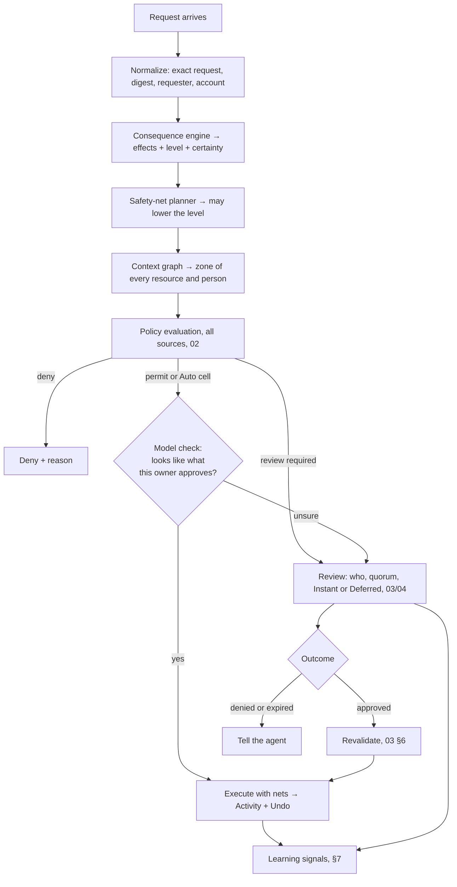

# 01 · Decision engine

How one request becomes **Auto**, **Ask** or (by explicit rule only) **Deny**. The engine is the same in every trust
mode; only where it runs and whose policies feed it differ (02, 06).

## 1. Pipeline



Invariants:

- Every step is deterministic except the model check, and the model can only turn **Auto into Ask**, never the
  reverse.
- An effect the engine can't determine with certainty is treated as its worst plausible level (§2.4).
- Nothing reaches a provider before the final policy recheck at the effect boundary (the authorization runtime's rule,
  kept).

## 2. Consequence engine

### 2.1 Effects

A request is compiled into a list of typed effects. The schema (Rust, `reins-policy::effects`):

```rust
enum Effect {
    FileRead   { path: PathRef, kind: FileKind },                 // FileKind: Source, Secret(SecretKind), Config, Other
    FileWrite  { path: PathRef },
    FileDelete { paths: Vec<PathRef>, recursive: bool },
    GitPush    { repo: RepoRef, refname: String, default_branch: bool, rewrites: bool, commits: u32 },
    GitRefDelete { repo: RepoRef, refname: String, merged: Option<bool> },
    Message    { channel: Channel, from: AccountRef, to: Vec<PartyRef>, attachments: Vec<AttachmentFacts> },
    Publish    { target: PublishTarget },                         // public repo, release, package, public post
    Permission { resource: ResourceRef, change: PermissionChange },
    Money      { amount: Money, merchant: MerchantRef, instrument: InstrumentRef },
    SecretOut  { secret: SecretRef, destination: DestinationRef },
    SecretUse  { secret: SecretRef, local_only: bool },
    Network    { host: HostRef, method: NetMethod },
    Infra      { target: InfraRef, change: InfraChange },         // terraform, kubectl, DB DDL, cloud CLIs
    Exec       { program: ProgramRef, source: CodeSource },        // a downloaded or generated program run
    Unknown    { reason: UnknownReason },
}
```

`PathRef`, `RepoRef`, `PartyRef` and similar carry the verified identity plus the facts the context graph needs (owner,
domain, workspace membership).

### 2.2 Sources of effects

| Request | How effects are built |
|---|---|
| Shell command (hooks, `reins ask`, the desktop guard) | parsed into a shell AST (bash/zsh/POSIX; PowerShell on Windows), with variables, globs and `cd` resolved where the hook supplies cwd and env. Each simple command maps through a **program model** (rm, git, find, mv, curl, psql, kubectl, terraform, gh, npm, cargo…) to effects. Pipelines: `x \| sh` is `Exec{source: Downloaded}`. |
| Inline code (`python3 - <<EOF`, `node -e`, `ruby -e`) | static analysis of the snippet for file writes/deletes, subprocess, network, and paths outside the workspace; string literals that merely *mention* paths are not effects |
| Git through the desktop proxy | exact: the pack's refs, the old and new tips, whether it's a fast-forward, the default branch from the host |
| Connector calls (Gmail, Calendar, GitHub API, Telegram, payments, vault) | each tool has a typed effect mapping, exact from the arguments: recipients, ref names, amounts |
| MCP tools | the server's annotations (`destructiveHint`, `readOnlyHint`, `openWorldHint`), plus per-server mappings Reins ships for common servers (Linear, Notion, Slack, Jira…); otherwise `Unknown` |

The keyword guard groups stay, but only as **labels** for humans ("Rewriting git history"), never as triggers.

### 2.3 Levels

| Level | Definition | Typical effects |
|---|---|---|
| **L0 Undoable** | nothing is lost or seen by anyone else | reads; builds and tests; writes and deletes in the workspace's generated or scratch areas; push to a non-default branch without rewrite; drafts |
| **L1 Recoverable** | something is lost, but a way back exists (provider-side, or a Reins net) | delete a branch (net: backup ref); force-push a non-default branch (net); `rm` in the workspace's source areas (net: trash); trash an email; close an issue |
| **L2 Reaches people** | someone else sees, receives or is notified | send email/message, comment, open/merge a PR into someone's default branch, calendar invite, preview deploy |
| **L3 Irreversible / far-reaching** | can't be undone, or changes who can do what, or spends | delete a repo; rewrite a default branch; `rm` outside the workspace without a net; drop a non-local DB; `terraform apply` on a non-dev target; permissions and keys; publish to the public; money; a secret leaving to a new destination; mass messaging (≥ 10 recipients, configurable) |

A request's level is the maximum over its effects, after nets.

### 2.4 Certainty

- `Full`: every effect is known exactly.
- `Partial`: something is unresolved (`$VAR` without env, `eval`, a generated script, an MCP tool without
  annotations). Each unresolved part is assumed to be its worst plausible effect *in the workspace's zone*, and the
  model rates risk (§6).
- `None`: Reins can't read it at all. This always asks, and the question names what couldn't be read ("Couldn't
  tell what this deletes").

### 2.5 Workspace

The **workspace** is the set of paths where an agent's work is expected:

- git worktrees of known repos;
- configured roots (`~/Documents/dev/**`, `~/src/**`, …);
- the OS temp directory, plus `~/.cache/**`;
- generated areas detected per toolchain (`target/`, `build/`, `node_modules/`, `DerivedData/`, `.gradle/`, `dist/`).

Writes and deletes in generated areas are L0. In source areas they're L1, with a trash net. Outside the workspace:
in `~` they're L3 unless netted; anything system-wide is always L3.

## 3. Context graph

The graph holds **verified** facts about resources and parties, refreshed from the providers. It never takes facts
from what the agent writes.

| Domain | Mine | Friends | Work | Outside |
|---|---|---|---|---|
| GitHub/GitLab repo | owner is you | another person's repo you can push to; or an org you tagged Friends | an org you tagged Work, or one your Managed account owns | anything else |
| Local path | in the workspace | — | in a worktree of a Work repo | outside the workspace |
| Email account (sender) | personal domain (Gmail, iCloud, your own domain) | — | Workspace or company domain | — |
| Email/message recipient | your own addresses or Saved Messages | in contacts, or written to before (≥ 1 sent) | same company domain as a Work account, or a directory member (Managed) | anyone else |
| Chat (Telegram, SMS) | Saved Messages, notes-to-self | 1:1 chats with history; groups you tagged | groups you tagged Work | new chats; large groups (> 20 by default) |
| Calendar | your own calendars | shared ones from Friends | Work calendars | — |
| Host (network) | localhost, your devices | — | your org's domains | anything else |

- **Multi-party effects take the least trusted zone**: one Outside recipient makes the whole message Outside.
- **Setup:** when Auto is turned on, the phone's model sorts the account metadata it can see into zones. It reads repo
  owners and orgs, sending accounts, sent-to domains and counts, contact groups, and chat names and sizes, never
  bodies, messages or code. You confirm on one swipe screen per service (01 §9.1).
- **Later questions** are folded into the next ask that involves the unknown party ("Who is octo? Work · Friends ·
  Outside").
- **Organizations** add their own zones and facts from the directory and managed connections (05). For example,
  *Production* covers a repo topic, an AWS account or a cluster name.

## 4. Default policy matrix (Personal mode)

`Auto` means "permit, subject to the model check"; `Ask` means review by the owner, Instant class.

| Zone \ Level | L0 | L1 | L2 | L3 |
|---|---|---|---|---|
| **Mine** | Auto | Auto | Auto (to Mine/Friends people) | Ask |
| **Friends** | Auto | Ask the first time per resource, then Auto | Auto (people you've written to) | Ask |
| **Work** | Auto | Ask | Ask | Ask |
| **Outside** | Ask | Ask | Ask | Ask |

Fixed overrides, whatever the cell:

- **Always Ask:**
  - money over the budget you set;
  - a secret leaving to a destination it hasn't gone to before;
  - publishing to the public;
  - permissions;
  - mass messaging;
  - certainty `None`.
- **Always reach a person, even in Bypass:** new AI connections and new phones.
- **Never Auto, but may be Deferred:** anything L3.

Cells are editable (02 §5): loosening needs a hold and the owner check; tightening is one tap.

## 5. Safety nets

The planner picks a net when one applies, runs it **before** the effect, and records it in Activity with an Undo:

| Effect | Net | Undo |
|---|---|---|
| `GitRefDelete`, `GitPush{rewrites}` on non-default | push `refs/reins/backup/<ref>/<ts>` (remote) or keep a local ref; 30 days | restore the ref |
| `FileDelete` in workspace source or `~` | move to `~/.local/share/reins/trash/<ts>/` (or the OS trash), keeping paths; 7 days | move back |
| `Message` by email | Gmail scheduled send +60 s (configurable 0–300 s) | cancel the scheduled send |
| `Message` by Telegram | none (delete-for-everyone isn't reliable) | — |
| GitHub merge into a Mine default branch | revert PR prepared on demand | open the revert |
| Email trash or archive | provider-native | restore |
| Calendar event created | provider-native | delete |

If a net fails, the effect doesn't run, and the request falls back to Ask.

## 6. The model's role

Laya (on the phone in Personal mode; the org's choice of model in Managed mode, 05) does four narrow jobs:

1. **Auto sanity check:** "does this look like what this owner approves in this zone?" Output: approve or ask, with
   a probability and the nearest past decisions. It reads the facts and the agent text separately and takes the
   stricter answer (today's rule, kept).
2. **Partial-certainty risk:** for unresolved parts, rates benign, risky, severe or catastrophic. Severe or worse
   forces Ask.
3. **Plain sentence:** writes the one-line effect a reviewer sees, from the effects (not from the agent's words).
4. **Zone proposals at setup** (§3), from metadata only.

Removed: the deny head and every "Autopilot denied" path. Memory, the per-profile adapter and agreement tracking stay,
trained on approve/ask labels.

## 7. Learning and promotions

- **Promotion offer:** after you approve the same (zone, effect kind, resource) 3 times in 14 days, the card shows
  **Let Auto do these here**. One tap writes an explicit rule (02), visible and removable in Settings › Auto › Rules.
- **Correction:** **Ask me next time** on an Auto entry writes an exception rule, pauses that (zone, effect kind) for
  24 h, offers Undo if a net exists, and is a 3× training example.
- **No silent drift:** the model never changes cells or rules. Only you, a repo file you accepted, or your org can.
- **Agreement metric:** how often the model's suggestion matched your decision, per zone. Shown in Trust; used only to
  tune the sanity-check threshold, never to unlock L3.

## 8. Rate and burst limits

- Per agent and per effect kind there's a sliding window: for example, more than 20 `GitRefDelete` in 10 minutes, or
  more than 5 L2 sends in 10 minutes. Going over it raises **one** review: "Claude Code deleted 24 branches in 6
  minutes: continue for this task?" Approving it covers the rest of the burst.
- This stops an agent laundering an irreversible outcome through many recoverable steps.

## 9. Experience

### 9.1 Turning on Auto

1. **Your world (zones):** one screen each for GitHub, email, messages and computers. Each item comes with a proposed
   zone and counts ("Acme · 14 repos · 3 people you mail"); swipe to confirm or fix.
2. **Matrix:** the §4 table with your real names in it; tap any cell to see examples and change it.
3. **Nets:** the send hold (on by default, 60 s) and the trash (on).
4. **Turn on:** a hold, then the biometric check.

### 9.2 What a review looks like

- **Title:** the plain sentence ("Delete 6 folders outside your projects").
- **Chips:** the zone (Work), the level (Can't be undone), the agent and the task, if any.
- **What happens:** the effects as rows; the raw command is behind Details.
- **Context question** folded in, if one is needed.
- **Buttons:** Deny · Approve, plus **Let Auto do these here** when it's offered. Deferred reviews add **Decide later**
  (03).

### 9.3 Activity

- Every decision says who and why:
  - "Auto · Mine · undoable · like 140 pushes you approved"
  - "Asked · Work · reaches people"
  - "Approved by Dana (Circle)"
  - "Required by Acme Security"
- Nets show Undo until they expire.
- The Auto filter shows only automatic decisions; the **Ask me next time** action lives there.

## 10. Modes, revised

| Mode | Behaviour |
|---|---|
| **Auto** (default once set up) | this document |
| **Auto off** (was Manual) | every request is a review; the model still suggests |
| **Overnight** | see §11 |
| **Bypass** | unchanged: everything, for a time; new connections and phones still reach you. In Managed mode it's available only if org policy allows, and is always audited |
| **Lockdown** | unchanged: deny everything, including what's waiting; new connections still reach you |

## 11. Overnight v2

Overnight means "Auto while you're away", with three changes:

1. **Ask becomes Deferred:**
   - The agent gets a ticket (03), told "parked until morning", and carries on.
   - At the time you set (or when you open Reins), you get **one digest** of parked reviews, grouped by agent and task.
     Each can be approved or denied, or you can **Approve all for this task**.
2. **People are stricter, your own work is looser:**
   - L2 to Outside or Work people is always parked.
   - L1 in Mine and Friends with nets is Auto (branch cleanup, force-pushes to feature branches).
   - L3 is always parked.
3. **No deny:** the old "If something is too risky: deny it" setting is removed. Parked items expire after the window
   you set (default: 12 h after the morning digest), and an expired item tells the agent "expired, not approved".

Overnight can carry a **task** (if one is set when it starts), which widens Auto inside the task's envelope.

## 12. Tasks (optional layer)

- **Envelope:** an agent connection; repos and branch globs; path roots; services and operations; people (none by
  default); budget; duration; and a level ceiling (default L1; L2 for Mine repos).
- **Started by:**
  - the agent: `reins_task_propose` (MCP) or `reins task start` (CLI);
  - you: from Activity's mode sheet;
  - Overnight.
- **Approval:** a review showing the envelope, editable before you approve.
- **Inside:** matrix cells up to the ceiling become Auto for matching requests. Fixed overrides (§4) still apply.
- **End:** time, `reins task end`, or Stop; then a digest.
- Tasks are per connection, and are visible in Activity as a live chip.

## 13. Metrics

Measured per day, per zone and per agent:

- **Ask rate** = asks ÷ requests. Target: under 3% for developer work, under 30% for messaging.
- **Real-risk recall:** on a labelled replay set (the 781 and growing), no labelled-risky request auto-approved.
  This gates releases.
- **Time to decision:**
  - Instant: median under 15 s.
  - Deferred: median under 2 h.
- **Timeout rate:** under 1%; was 5%.
- **Correction rate** ("Ask me next time" ÷ Auto): under 0.5%.
- **Net usage:** how often Undo is used. A high rate means a cell is too loose.

The replay harness (07 §3) runs every engine change against the recorded history before it ships.
