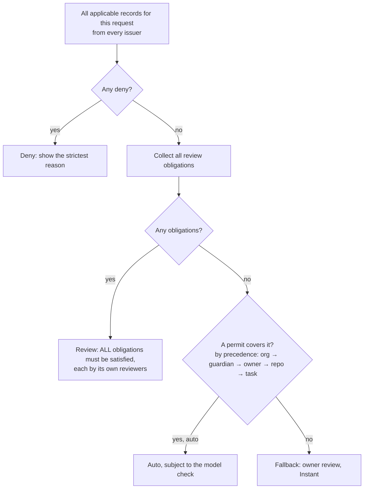

# 02 · Policy and authority

One policy model serves every source of rules:
- you;
- a repo's rules file;
- a task;
- a person you share control with;
- a guardian;
- your employer.

It extends the existing authorization foundation (`docs/authorization.md`, `docs/authorization-runtime.md`,
`docs/permissions-and-delegations.md`): versioned, issuer-signed policy records with scopes, conditions, effects,
obligations, budgets and receipts. Nothing here weakens its rules: mandatory deny and review always win, unknown facts
never widen, and authority must be proven, never claimed.

## 1. Principals

| Principal | Who | Can author policy over |
|---|---|---|
| **Owner** | the person whose account it is | their own Personal account |
| **Circle member** | a Reins user the owner invited (04) | nothing by themselves; they *satisfy* reviews the owner (or a guardian arrangement) assigned to them |
| **Guardian** | a Reins user with a consented guardianship over a ward's account (04 §4) | review obligations on the ward's account, within the scope the ward accepted |
| **Organization roles** | Org owner, Security admin (CISO), Policy author, Approver groups, Auditor, Member (05 §3) | the organization's Managed profiles, by role |
| **Repo** | a repository's `.reins/rules.toml` on its default branch | that repo's resources, stricter freely, looser only with acceptance (§6) |
| **Task** | an approved envelope (01 §12) | temporary permits inside its envelope, never past its ceiling |
| **Agent** | an AI connection | **nothing**. It can propose (a task, a rule change in a repo); a principal decides. |

An organization never gets authority over a person's Personal account, and the same goes the other way. They're
separate profiles (06 §2).

## 2. Policy record (extended)

The existing `PolicyRecord` gains the fields Decisions v2 needs, as a new schema version. Older clients that can't
decode them hold the policy rather than ignore it (the existing rule):

```
PolicyRecord v2
  id, revision, issuer {kind: owner|guardian|org|repo|task, id, signature}
  lifecycle: active | paused | revoked
  validity: {not_before, not_after}
  scope:
    accounts / connections (agents) / operations     -- exact tuples (existing)
    zones: [Mine, Friends, Work, Outside, <org zones>] -- new
    levels: [L0..L3]                                  -- new
    effects: [effect kinds + facets]                  -- new, e.g. GitRefDelete{merged:true}
    resources: exact ids or globs where allowed       -- repo "dkat/reins", branch "fix/*"
  conditions: verified facts only (time windows, device posture, task id, budget left)
  effect:
    deny
    | permit { auto: bool, budget, uses, expiry }
    | review { reviewers: ReviewerSet, quorum: n, distinct_persons: bool,
               exclude_requester: bool, class: instant|deferred, window,
               on_expiry: deny|escalate(ReviewerSet) }
    | park { until: time|event }                      -- Overnight, maintenance windows
  delegation_parent: optional policy id (existing bounded delegations)
  explanation: short text shown to users ("Acme requires Security to approve production deploys")
```

`ReviewerSet` is one of:
- `owner`;
- a list of specific persons (verified Reins identities);
- a Circle;
- an org group or role (`Security`, `Team lead of <member>`, `On-call: payments`);
- a guardian;
- an expression combining them: `owner AND (any of Security)`.

## 3. Evaluation and precedence

> **Read with 08 R3:** matrix cells are soft defaults that permits satisfy. Fixed overrides, Circle, guardian, org and repo `review` rules are hard. Permits combine as OR, while tasks and delegations are AND bounds. That replaces the issuer-ordered permit list below.



Rules:

1. **Deny beats everything.** Among denies, the reason shown is the highest issuer's.
2. **Obligations add up.** If your own matrix says Ask *and* your employer requires Security's sign-off, both must
   approve. One approval never satisfies two obligations with different reviewer sets, unless the same person
   legitimately belongs to both and the record allows it (`distinct_persons: false`).
3. **Permits never override obligations.** A task, a repo rule or Bypass can't satisfy an org's or a guardian's review
   requirement. Bypass in Personal mode keeps its existing meaning for the owner's *own* obligations only.
4. **Issuer ceilings:**
   - a lower issuer can only narrow what a higher one permits;
   - an org's Managed profile has no "owner permits wider than org";
   - a repo can't permit beyond the owner's matrix without the owner's acceptance;
   - a task can't exceed its ceiling.
5. **Unknown facts are Outside and L3**, so they can't satisfy a permit's conditions. That includes an unverified
   zone, unresolved recipients and certainty `None`.
6. **Determinism:** the same inputs and policy snapshot always give the same decision. The snapshot's hash is recorded
   with every decision (06 §5).

## 4. Decision trace

Every decision stores a trace: which records applied, what each said, which won, and the facts used (zones, levels,
nets, budgets). The trace shows up in three places:

- **Users** see one line in Activity, and **Why** expands it:
  - "Asked because: Work · reaches people (your matrix). Also required: Acme Security (org policy *prod-deploys*)."
- **Admins** (Managed mode) see the full trace in the audit log (06 §5).
- **Simulation** replays a draft policy over the retained history and shows what would have changed: "312 Auto → 12
  Ask, 0 Ask → Auto". Policy authors must run it before saving (Managed mode) and see it as a preview (Personal mode).

## 5. Personal policy authoring

| Surface | Writes |
|---|---|
| Settings › Auto › Matrix | cell permits/reviews per (zone, level), per domain if the owner splits them |
| Settings › Auto › Your world | zone assignments (facts, not policy) |
| Settings › Auto › Rules | explicit rules: promotions (01 §7), exceptions (from "Ask me next time"), custom rules |
| Approval card, **Let Auto do these here** | one permit scoped to (zone, effect kind, resource) |
| Settings › Circles | review obligations that name Circle members (04) |

Loosening anything (a cell, a rule, a Circle member's ability to approve for you) needs the hold and the owner check.
Tightening is one tap.

## 6. Repo rules (`.reins/rules.toml`)

```toml
# .reins/rules.toml — read only from the default branch
version = 1

[[rule]]
when = { effect = "GitPush", branch = "release/*" }
review = { reviewers = "owner", class = "deferred", window = "24h" }
explain = "Releases are reviewed."

[[rule]]
when = { effect = "GitPush", branch = "fix/*", rewrites = true }
permit = "auto"          # looser than the owner's Friends L1 default → needs acceptance
explain = "Force-pushing fix branches is routine here."

[[rule]]
when = { effect = "Infra", target = "terraform:prod" }
deny = true
explain = "Production changes go through CI only."
```

- **Stricter** rules (deny, review) apply as soon as they're on the default branch.
- **Looser** rules (permit) show once as a card: "dkat/reins wants Auto for: force-pushing fix/* branches. Accept ·
  Not now". Changing the file re-asks.
- The file can't touch:
  - invariants;
  - other repos;
  - people effects beyond the repo (it can't permit sending email);
  - org obligations.
- In Managed mode, an org setting decides whether repo rules may loosen at all (default: no).

## 7. Organization policy authoring (summary; details in 05)

- **Policy as code:** org policies live in a git repo the org owns (`acme/reins-policy`) or in the admin console. Both
  produce signed `PolicyRecord`s from the org's issuer key (06 §3).
- **Changes:** go through review (two admins by default), simulation on the org's retained history, and staged
  rollout (pilot group → everyone).
- **Templates:**
  - *Developer baseline*;
  - *Production change control*;
  - *Customer data*;
  - *Finance*;
  - *Executive assistant*.

## 8. Budgets, receipts, idempotency

- **Budgets** (existing): count uses and amounts per permit and delegation, are spent atomically before the effect,
  and reach durable history first.
- **Receipts** (existing): Started → Unknown → Succeeded. A conflict holds.
- **New: deferred reviews carry the request digest.** An approval applies only to the exact request it was asked about
  (03 §6 covers what happens when the world changed meanwhile).

## 9. What an agent may learn about policy

- **Deny or expiry:** the agent is told it was denied, plus the explanation the issuer wrote. It never sees policy
  internals, other accounts or reviewer identities, unless the explanation names them.
- **Deferred:** the agent gets a ticket and an expected window ("decision expected within 4 h"), so it can plan.
- **Task propose:** the agent sees the approved envelope (it needs it to stay inside), not the rest of the policy.
