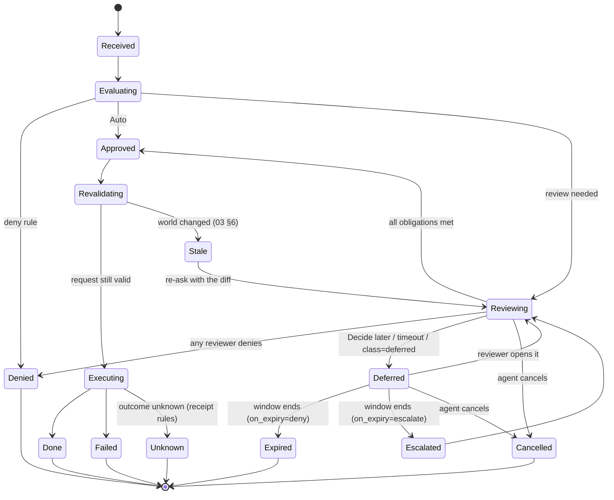

# 03 · Decision lifecycle and async decisions

Some decisions take seconds; some need someone who is in a meeting, asleep, or in another time zone. Reins supports
both without making the agent sit idle.

## 1. Two classes

| Class | Agent | Window | Used for |
|---|---|---|---|
| **Instant** | waits (the tool call or hook blocks) | default 2 min, max 10 min (today's relay limit) | the owner's own routine reviews; anything the agent can't continue without |
| **Deferred** | doesn't wait: it gets a **ticket** and carries on | default 4 h, max 7 days | other people's reviews (Circle, guardian, org approvers); L3 changes; anything parked by Overnight; anything the reviewer chose **Decide later** for |

The class is chosen in this order:

1. **Policy:** a review obligation states it (02 §2 `class`).
2. **The agent's hint:** an agent can ask for deferred (`defer: true` on the MCP call, `reins ask --defer`), for
   example when it has other work to do. It can't force instant on something policy made deferred.
3. **The reviewer:** on an Instant card, **Decide later** converts it to Deferred (the agent is told at once and
   continues).
4. **Timeout:** an Instant review nobody answered in its window becomes Deferred automatically, if policy allows.
   Today it simply times out (5% of requests).

## 2. Request state machine



- Each transition is a signed, durable event in the request's history, which is what the audit log shows (06 §5).
- Partial approvals (one of two required reviewers) stay in Reviewing, with progress shown.

## 3. Who executes a deferred action

The rule: **whoever holds the credential executes, at approval time, against the exact approved request.**

| Request kind | Executor | Agent involvement after approval |
|---|---|---|
| Connector actions (send email, calendar, GitHub API, Telegram, payments) | the approval device (Personal), or the org's executor (Managed, 05 §5) | none: the agent gets the result |
| Git push through the desktop proxy | the desktop app, from the pack it captured, as a compare-and-swap on the remote ref | none: the agent is told "pushed" or "stale" |
| Shell command (hook, `reins ask`) | the agent's own process, because Reins can't run arbitrary commands for it | the agent re-runs the command; the hook lets that exact command through once (digest-bound) |
| MCP tool on a remote server | the phone (Personal) or the org's executor (Managed) | none |
| Secret release (`reins run`, API proxy) | the desktop app, when the agent asks again with the ticket | the agent retries with the ticket |

## 4. Agent protocol

### 4.1 MCP (Claude.ai, ChatGPT, Claude Code, Codex, Cursor…)

A tool call that becomes Deferred returns immediately with a structured, non-error result:

```json
{
  "status": "pending_review",
  "ticket": "rt_8F3k…",
  "summary": "Send email to ann@acme.com — waiting for Dana's approval",
  "expected_by": "2026-10-27T15:00:00Z",
  "next": "Continue with other work. Call reins_get_result with this ticket later, or reins_wait to block up to 10 minutes."
}
```

| Tool | Purpose |
|---|---|
| `reins_get_result(ticket)` | returns the current state; on approval, the action's result (connector actions are executed by Reins) |
| `reins_wait(ticket, max_seconds)` | long-polls up to 10 minutes |
| `reins_cancel(ticket)` | withdraws the request (e.g. no longer needed) |
| `reins_tickets()` | lists this connection's open tickets |

Notification:
- Where the client supports MCP resource subscriptions, each ticket is a resource (`reins://tickets/<id>`), and
  Reins sends `notifications/resources/updated` when it changes.
- Where the client supports the MCP long-running task model, the ticket maps onto it.
- Otherwise the agent polls, and the `next` text tells it how.

### 4.2 Coding agents through the desktop app (hooks, `reins ask`)

- **Instant:** as today; the hook blocks.
- **Deferred:** the hook returns a block with a message the harness shows the model:
  `Parked for review (ticket rt_…, expected within 4 h). Continue with other work; when it's approved, re-run this exact command.`
- **The desktop daemon keeps an inbox per session.** On any later hook call from that session (a `PreToolUse`, a
  `UserPromptSubmit` or a `Stop` hook), it injects the news as additional context:
  `Reins: rt_… (git push --force origin fix/ci) was approved by Dana — re-run it now.` It also covers expiry and
  denial.
- The approved command passes the guard once, matched by digest, within its validity (default 1 h after approval).
- `reins tickets` and `reins wait <ticket>` exist for scripts and for agents that prefer polling.

### 4.3 Git push

- A deferred push returns `remote: Reins: parked for review (ticket rt_…). It will be pushed when approved; you can
  keep working.`, and git exits non-zero, so CI scripts don't think it landed.
- On approval, the desktop app pushes the captured pack, with `--force-with-lease` semantics on the old tip. If the
  remote moved, the request is **Stale** (§6).

### 4.4 Cloud agents and webhooks

- A connection can register a **callback URL** (HTTPS only, verified by a challenge).
- Reins POSTs a signed event (`ticket.approved`, `ticket.denied`, `ticket.expired`, `ticket.stale`) with the ticket
  and result. The signature is Ed25519 over the body, with the key published per connection.
- This is for server-side agents and orchestrators, so they can resume work without polling.

## 5. Reviewer experience

### 5.1 Instant

- As today: a notification, then the approval card.
- The card adds **Decide later** (it becomes Deferred and the agent is unblocked).

### 5.2 Deferred

- **Inbox:** Activity gets a **Waiting for you** section above Today, sorted by deadline, grouped by agent and task.
- **Notifications:** one when a deferred review arrives (quiet by default; priority if the window is under 1 h), then a
  reminder at 50% and at 90% of the window. Quiet hours respect the OS focus mode, except for org reviews marked
  urgent.
- **Digest:** "3 waiting: 1 from Claude Code (release v2.1), 2 from ChatGPT (emails to Acme)", at times you choose.
- **Batch actions:** approve or deny everything from one task; approve all of one kind ("all 4 emails to Acme").
  Batch never crosses L3.
- **Comment:** any reviewer can attach a short note. The agent receives it on denial ("Denied: use the staging
  bucket").
- **Ask a question back:** a reviewer can reply "Why?". The agent gets it as the ticket's state (`needs_info`) and can
  answer with `reins_reply(ticket, text)`. The answer appears on the card. The agent's text is labelled as the agent's
  and never changes the facts.

## 6. Revalidation (the world changed)

Between ask and approve, minutes or days can pass. Before executing, the engine re-runs the consequence engine and
policy on the *current* world:

- **Same request digest, same effects, policy still allows:** execute.
- **Effects changed:** the remote branch moved, a recipient's zone changed, a price changed, the repo became a Work
  repo, an org policy was added. → **Stale**, re-ask the review with a diff: "Since you approved: main moved by 2
  commits."
- **The agent changed the request:** it's a new request (new digest) and a new ticket. Approvals never transfer.

Approvals expire if not executed (default 1 h for agent-run commands, 24 h for executor-run actions).

## 7. Expiry and escalation

Policy decides what happens when a window ends:

- `on_expiry: deny` (default): Expired; the agent is told "expired, not approved".
- `on_expiry: escalate(ReviewerSet)`: e.g. on-call backup, or a manager. The window restarts once.
- Owner fallback (Personal): an unanswered Circle review can fall back to the owner if the arrangement allows it
  (04 §3).

## 8. Fairness and safety

- **Request flooding:** at most N open deferred tickets per connection (default 50). Beyond that, the agent is told
  to wait. Duplicate requests (same digest) share a ticket (today's dedupe, extended).
- **Order:** tickets don't execute out of order when they touch the same resource (two pushes to one branch).
  Executors serialize per resource.
- **Visibility:** an agent sees only its own tickets.

## 9. Storage and privacy of parked requests

- **Personal:**
  - A parked request's body is stored on the server **sealed to the reviewers' devices** (the approval device, plus any
    Circle or guardian reviewers, 04 §5).
  - The server keeps only metadata: ticket, state, deadlines, connection, and the request digest.
  - The agent's original call reached the server over TLS, as today. The change is that it isn't kept in clear once
    parked.
- **Managed:** stored by the org's decision service under its retention policy (06 §4).

## 10. Migration from today

| Today | Becomes |
|---|---|
| 10-minute relay wait, then "call `reins_get_result` later" | Instant (2 min default), then auto-Deferred |
| `reins_get_result` | ticket-based, with `reins_wait`, `reins_cancel`, `reins_tickets` |
| Late answers kept 10 min | Deferred window, per policy (up to 7 days) |
| Hooks block or fail | hooks also support park and resume through the daemon inbox |
