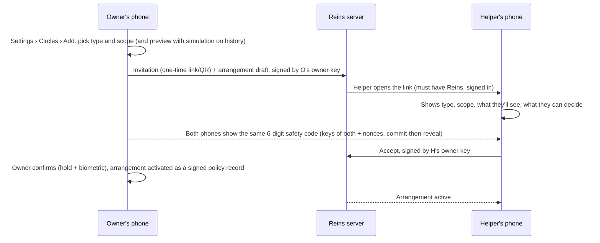
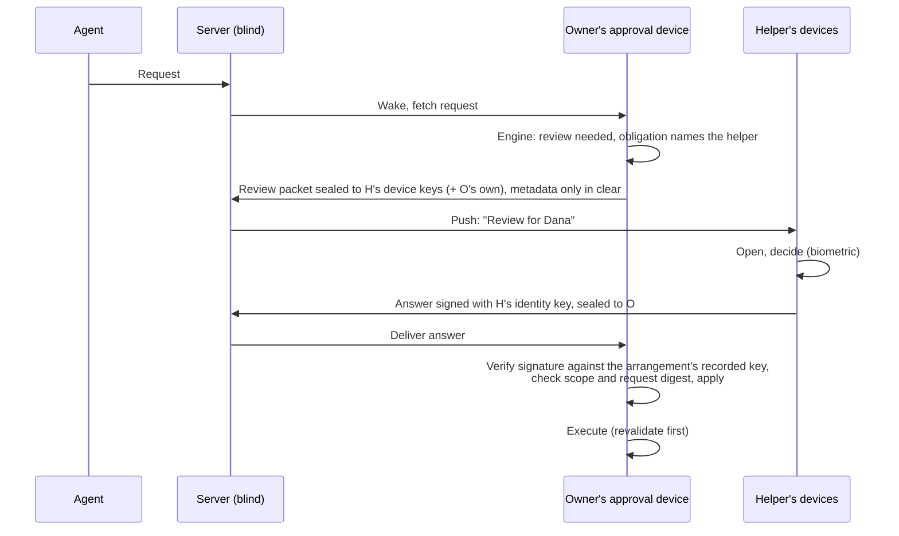

# 04 · Shared control between Reins users

People already share responsibility:
- an assistant who sends emails for you;
- a co-founder who must also sign off on payments;
- parents who confirm what a teenager's agent does;
- a boss who approves certain actions.

Reins makes that explicit, verifiable and private.

This document covers **Personal mode** (people with their own Reins accounts). In organizations the same ideas run on
org roles and groups (05 §6); a manager's approval at work belongs there, not here.

## 1. Arrangements

An **arrangement** is a signed agreement between two or more Reins users about one account's decisions:

| Arrangement | Who decides | Example | Default visibility for the helper |
|---|---|---|---|
| **Delegate** | the delegate **or** the owner (either is enough) | "Maria can approve emails I send to clients" | the request card, as the owner would see it, within the scope |
| **Co-sign** | the owner **and** the co-signer (both) | "Payments over $500 need Alex too" | the card within the scope |
| **Guardian** | the guardian, as an obligation the ward accepted (the ward may also have to approve) | "Mom approves purchases and new contacts for Sam's agent" | the card within the scope, plus a weekly digest of Auto decisions in scope (opt-in) |
| **Watcher** | nobody new; the helper is informed | "My partner sees when Bypass is turned on" | notifications and digest only, no buttons |

Every arrangement is built from 02's records:
- **Delegate:** `review {reviewers: owner OR delegate}`.
- **Co-sign:** `review {reviewers: owner AND co-signer, distinct_persons: true}`.
- **Guardian:** a guardian-issued obligation.
- **Watcher:** a notification rule.

So precedence, simulation and tracing work the same as for any other policy.

## 2. Scopes

A scope is what the arrangement covers, written as effect filters (01 §2), never as raw tools:

- by **effect and zone**: "Message to Work or Outside people", "Money over $100", "GitRefDelete on Work repos";
- by **account**: "anything sent from founder@startup.com";
- by **agent or task**: "anything the ChatGPT connection does";
- by **level**: "all L3".

Each scope also says:
- the **class**: Instant if the helper is expected to be at hand; Deferred is the usual;
- the **window**;
- **on expiry**: deny, or fall back to the owner (Delegate only).

## 3. Setting one up

- The safety-code step uses the same commit-then-reveal exchange as phone enrollment (`reins_proto::enroll`). A server
  can't swap in its own key without a one-in-a-million guess per attempt.
- Either side can view the arrangement at any time: type, scope, history, and what was decided.
- **Changes:**
  - **Widening a scope:** the owner proposes, the helper accepts.
  - **Narrowing:** the owner alone.
  - **Leaving:** the helper alone can leave any arrangement at any time.

## 4. Guardianship (care, not control)

Guardianship is the one arrangement where the helper's obligation binds the owner. It has extra safeguards:

- **The ward sees** the scope, every decision the guardian made, and any comments.
- **The ward can't silently remove it.** Ending a guardianship starts a notice period the ward chose at setup (0, 3 or
  7 days, shown up front), and notifies the guardian. During it, the obligations stay.
- **Adults can always leave:** the notice period caps at 7 days, and there's no "permanent" option.
- **Minors:** if the ward's account is marked as a minor's (by the guardian, with age confirmation through the
  platform's family features where available), leaving needs the guardian's consent.
- **No secret reading:** the guardian's view is the request card within scope. No inbox, no chat history, no vault. A
  "Watcher" digest is opt-in by the ward.

## 5. Privacy and cryptography (Personal mode stays end-to-end)

The owner's approval device holds the credentials and executes. Helpers only see review packets and send signed
answers.

- **Packets** are sealed (X25519 + XChaCha20-Poly1305, as sealed answers today) to each of the helper's enrolled
  devices: their approval device and second phones.
- **Answers** are Ed25519-signed by the helper's identity key over (arrangement id, request digest, decision, time,
  nonce). The owner's device verifies them against the arrangement record. The server can't forge, replay or redirect
  them.
- **Redaction:** each scope says what the packet contains:
  - *full* (the card as the owner sees it);
  - *summary* (the effects and sentence, no bodies);
  - *custom* (e.g. subject and recipients, but not the body).
  Default: summary for Guardian, full for Delegate and Co-sign.
- **Execution needs the owner's approval device online,** because it holds the credentials. If it's offline when the
  helper approves, the request stays Approved and executes when the phone is reachable. Revalidation applies (03 §6),
  and the ticket shows "approved, waiting for the owner's phone".
- **Receipts** go both ways: the helper's Activity keeps a "decided for Sam" entry, and the owner's keeps "approved by
  Mom".

## 6. Experience

### 6.1 Owner

- **Settings › Circles:** people, arrangements, scopes, history, Pause and End.
- **Cards** show who else must decide ("Needs Alex too"), and progress ("Alex approved, waiting for you").
- **Activity** names the helper on every decision they made.

### 6.2 Helper

- A **For others** section in Activity: reviews waiting, grouped by person, with their deadlines.
- Cards look like your own, with the person's name and avatar on top ("Sam's ChatGPT wants to buy…"), plus the
  arrangement's scope line.
- Notifications are titled by person: "Sam: purchase $42 waiting".

### 6.3 Watcher

- A digest and notifications, with no buttons ("Sam turned on Bypass for 1 h").

## 7. Abuse and failure cases

| Case | Handling |
|---|---|
| A delegate approves something harmful | scope limits; the owner is notified of every delegate decision (default on); Undo where nets exist; the owner can pause the arrangement instantly |
| The helper's phone is compromised | the attacker can only approve within scope; the owner sees each approval; ending the arrangement revokes the key |
| A guardian uses it coercively | the ward sees everything decided; adults can leave within ≤ 7 days; guardians can't read content outside scoped cards |
| The server lies about an answer | answers are signed by the helper and verified on the owner's device |
| The helper is unavailable | the scope's on-expiry rule: deny, or fall back to the owner (Delegate) |
| The owner and helper disagree (Co-sign) | either deny wins |

## 8. Relationship to organizations

- A **boss** in Personal mode is a Co-signer or Delegate, which suits a small team without a Managed org.
- In Managed mode, approvals come from org roles and groups (05 §6), with the same card and lifecycle. A Personal
  arrangement can never cover a Managed profile's requests, and the same goes the other way.
