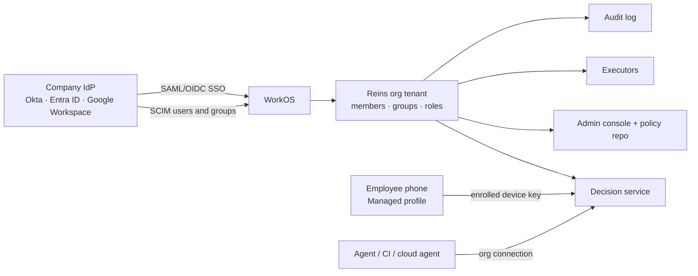

# 05 · Organizations (Reins for companies)

A company wants its people's AI agents to be useful, without giving each agent (or each employee's phone) the keys to
production, customer data or the bank. It needs four things:

- central rules set by security (a CISO);
- easy onboarding and offboarding;
- credentials it owns and can revoke;
- an audit trail an auditor accepts.

Reins for organizations is a separate **trust mode, Managed** (06), built on the same engine, policy model and
lifecycle.

## 1. What a company gets

| Need | Reins provides |
|---|---|
| "Our agents should follow our rules" | org policy (02) with templates; simulation before rollout; mandatory obligations nobody can bypass |
| "Use our accounts, not personal ones" | **managed connections**: org GitHub App, Google Workspace, Slack, Jira, cloud roles, databases and the org vault, set up once by IT |
| "Joiners get access, leavers lose it, instantly" | SSO plus SCIM provisioning; deprovisioning revokes devices, connections and tickets within a minute |
| "The right person approves" | approval routing to groups, on-call and managers, with escalation and SLAs; no self-approval |
| "Prove it to the auditor" | an append-only, hash-chained decision log; SIEM export; SOC 2 / ISO 27001 evidence reports |
| "Don't make engineers miserable" | the same Auto engine: routine work in sanctioned zones is Auto; reviews are rare and fast |

## 2. Tenancy and identity

- **Org tenant:** created by an Org owner, who verifies the domain (DNS TXT record).
- **SSO:** SAML or OIDC through WorkOS (already used for Reins sign-in). Members sign in to their Managed profile only
  through SSO; passwords are disabled for Managed profiles.
- **SCIM:** users and groups sync from the IdP. Groups map to Reins groups (approver groups, teams, zones).
- **Deprovisioning** (SCIM delete or suspend) does five things:
  - revokes the member's devices and agent connections;
  - cancels their open tickets, or reassigns them per policy;
  - transfers the reviews waiting for them to their group's backup;
  - kills any credential leases;
  - writes all of it to audit.

  Target: under 60 seconds.
- **Personal accounts are untouched.** An employee's own Personal account is never visible to the org (06 §2).

## 3. Roles

| Role | Can |
|---|---|
| **Org owner** | billing, domain, SSO and SCIM setup, assign admins; break-glass |
| **Security admin** (CISO, security team) | author and approve org policy; define zones; configure managed connections; see the full audit; set retention and export |
| **Policy author** | draft policy and run simulations; can't activate (needs a Security admin's approval) |
| **Connection admin** (IT) | install and rotate managed connections and executors; can't author policy |
| **Approver** (via groups) | satisfy reviews routed to their groups |
| **Auditor** | read-only audit and reports; can't see request bodies unless retention keeps them and policy grants it |
| **Team lead** | manage their team's agent connections and team-scoped rules within org ceilings; approve for their team when routed |
| **Member** | use agents through Managed connections; approve their own reviews where policy lets owners decide; see their own history |

Admin actions use two-person approval by default (policy activation, retention changes, executor changes). An admin
can't approve their own change.

## 4. Managed connections

The org connects its own systems once. Members' agents act through them, and members never hold the credentials.

| System | How Reins connects | Credential lives in |
|---|---|---|
| GitHub / GitLab | org-installed GitHub App (fine-grained, per-repo); the token is minted per action, short-lived | org executor (§5) |
| Google Workspace (Gmail, Calendar, Drive) | domain-wide delegation for a scoped service account, impersonating the requesting member only; scopes chosen by Security | org executor, or the customer's KMS |
| Microsoft 365 | Entra app with admin consent, Graph scopes per policy | org executor |
| Slack, Jira, Linear, Notion | org-level OAuth apps | org executor |
| AWS / GCP / Azure | role assumption (IAM Identity Center, workload identity federation); STS credentials per action, minutes long | issued just-in-time, never stored |
| Databases | through a proxy the org runs (e.g. a bastion), with per-action temporary DB users | the proxy |
| Secrets | the org vault (Reins org vault, or connectors for 1Password Business, HashiCorp Vault, AWS Secrets Manager) | the vault; released per action as leases |
| Internal MCP servers | registered by Connection admins, with per-tool effect mappings (01 §2.2) | the executor |

**"Connect with accesses already set up":** when a member signs in to the Managed profile, their agents
automatically see the managed connections that member's groups are entitled to. There's nothing to connect on the
phone.

## 5. Executors

- In Managed mode, actions are executed by an **org executor**, not by an employee's phone:
  - **Reins Cloud** hosts it per org, in an isolated tenant runtime;
  - **Dedicated** gives the org a single-tenant deployment in its own region;
  - **Self-hosted** runs it in the org's VPC (the server is open source, AGPL; the executor is a separate binary).
- **Executors:**
  - hold or fetch the managed credentials;
  - run approved actions exactly as approved (digest-bound);
  - apply safety nets (01 §5);
  - write receipts.
- **Desktop and coding agents** still run through the member's desktop app, enrolled to the org. Git credentials come
  from the executor as short leases (like today's desktop app, but issued by the org instead of a phone).
- Phones in Managed mode are **approval devices only**: they show cards and sign decisions with device keys enrolled
  to the org.

## 6. Approval routing

Review obligations (02) name org reviewers:

- **Groups:** "any of Security", "2 of Finance".
- **Relationships:** "the requester's manager" (from the IdP), "the repo's code owners" (from CODEOWNERS), "the
  resource owner" (a tag).
- **On-call:** from PagerDuty, Opsgenie or Incident.io schedules ("on-call: payments").
- **Rules:**
  - `exclude_requester` is on by default: no self-approval;
  - separation of duties (`distinct_persons`);
  - four-eyes on production;
  - time-boxed approvals.

Escalation and SLAs:
- each obligation has a window;
- on expiry it escalates (backup group, manager, then Security admin);
- SLA reports show time to decision per group.

Channels:
- the Reins app is the canonical approval surface (signed device decisions);
- Slack and Teams buttons can be enabled for L0–L2 reviews. They open a signed web approval that requires SSO plus
  device-bound passkeys. L3 always needs the app.

## 7. Org policy in practice

### 7.1 Zones and facts the org defines

- **Org zones:**
  - *Production*: AWS accounts tagged prod, k8s contexts `prod-*`, repos with topic `production`;
  - *Customer data*: databases, S3 prefixes, Drive folders;
  - *Finance*: the bank and payment providers;
  - *Public*: anything that publishes.
- **Facts** come from verified sources: IdP groups, cloud tags, the GitHub API, the CMDB. They never come from the
  agent.

### 7.2 Templates (starting points)

| Template | Highlights |
|---|---|
| **Developer baseline** | L0–L1 Auto in the member's repos and the org's non-prod; L2 to colleagues Auto; external email reviewed by the member; L3 reviewed by the member + code owners |
| **Production change control** | any Infra effect on Production → review by on-call + a second engineer, deferred, 4 h; outside change windows → also Security |
| **Customer data** | reads of Customer data → reason required, logged; exports and sends → Security review; no Bypass |
| **Finance** | Money > $1,000 → Finance group, 2 of N; new payee → Finance + requester's manager |
| **Executive assistant** | delegate an exec's email and calendar to an assistant group within scope (04's Delegate, run on org roles) |

### 7.3 Lifecycle of a policy change

1. Draft, in the console or as a PR to the org's policy repo (`acme/reins-policy`).
2. Simulation on the org's retained history: "Ask rate +2.1%, 0 → Auto, 318 → Ask; top affected teams".
3. Review: two Security admins.
4. Staged rollout: a pilot group, then 25%, then everyone, with automatic rollback if the ask rate or SLA crosses a
   set threshold.
5. Activation: signed by the org issuer key (06 §3). Phones and executors pick it up within a minute.
   Effective-version pinning is recorded in every decision.

## 8. Agent fleet

- **Allowed agents:** the org lists which AI clients may connect (Claude Code, Codex, ChatGPT Enterprise, internal
  agents), and which versions.
- **Service agents** (CI bots, scheduled cloud agents) get **service identities** owned by a team, with their own
  policy. Their reviews go to the owning team.
- **Per-team connections:** a team lead creates connections for the team, within org ceilings.
- **Kill switch:** Security can pause one agent type org-wide (e.g. after a vulnerability) in one action. It's
  Lockdown, scoped.

## 9. Members' experience

- **Joining:** IT adds the user (SCIM). The member installs Reins, chooses **Add work account**, signs in with SSO,
  and approves device enrollment (an MDM can push the managed app config, 06 §6). The Managed profile appears next to
  their Personal one.
- **Daily:** agents act through managed connections. Routine work is Auto by policy, and the few reviews look like
  personal ones, with an org badge ("Acme · requires Security").
- **Their own data:** a member sees their own history and why each decision went the way it did. An auditor's access
  to their requests is itself logged.
- **Leaving:** the Managed profile disappears from the device; the Personal one stays.

## 10. Reporting

Dashboards for Security and team leads:
- ask rate by team and agent;
- top policies hit;
- time to decision;
- expired reviews;
- bypass use (if allowed);
- denied effects;
- new external recipients and domains;
- secret releases.

Each shows trends against the targets set in policy.

## 11. Pricing tiers (indicative)

| Tier | For | Includes |
|---|---|---|
| **Personal** | individuals | everything in 01–04; free during alpha |
| **Team** (Managed, see 08 R11) | small teams with Google Workspace or GitHub org sign-in | a shared org, Google or GitHub sign-in, groups, basic policy, a 30-day audit |
| **Business** | companies | SSO, SCIM, managed connections, templates, routing, a 1-year audit, SIEM export |
| **Enterprise** | regulated | dedicated or self-hosted, BYOK/HSM, data residency, custom retention, SOC 2 report access, priority support |
