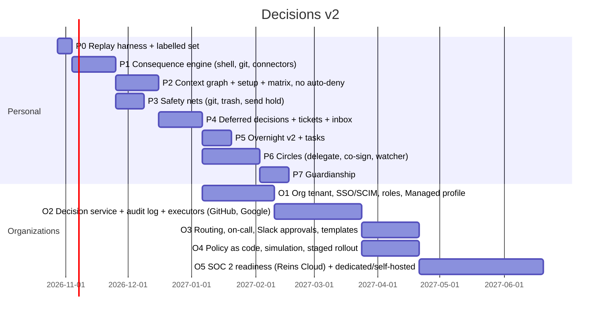

# 07 · Roadmap

Ordered so every phase ships something users feel. Each phase is measured on the replay harness before it ships.

## 1. Phases

Dates are planning placeholders from today; they move with the alpha's priorities.

| Phase | Ships | Success |
|---|---|---|
| **P0 Replay harness** | a labelled corpus (the 781 desktop requests + phone connector history exported by consent); `reins-replay` runs any engine or policy on it | every later phase reports ask rate and real-risk recall against it |
| **P1 Consequence engine** | shell AST + program models, inline-code analysis, git exact facts, connector effect maps, MCP annotations; the guard becomes labels only | false alarms on the corpus: 0 of the 64 known false positives; 100% of labelled risks still flagged |
| **P2 Context + matrix** | zones (setup screens, folded-in questions), matrix policy, the model as an approve/ask sanity check, auto-deny removed, "Ask me next time" | developer ask rate ≤ 5% on replay; no labelled risk Auto |
| **P3 Safety nets** | backup refs, trash, Gmail send hold with Undo, revert for own-repo merges | ask rate ≤ 3%; Undo works in drills |
| **P4 Deferred** | tickets, `reins_wait`/`reins_cancel`/`reins_tickets`, the hook inbox, git deferred push, the Waiting-for-you inbox, reminders, revalidation, sealed parked bodies | timeout rate < 1%; no Instant review older than 2 min |
| **P5 Overnight v2 + tasks** | parking with a morning digest; tasks (propose/approve/live chip/digest) | overnight runs complete with ≤ 3 morning decisions per agent-night |
| **P6 Circles** | delegate, co-sign and watcher; sealed review packets; signed answers; For-others inbox | an end-to-end test with two accounts; a security review passed |
| **P7 Guardianship** | notice periods, minor accounts, ward visibility | a security and abuse review passed |
| **O1 Orgs foundation** | org tenant, domain verification, WorkOS SSO and SCIM, roles, Managed profile on phone and desktop, deprovisioning in < 60 s | a pilot org (us) is provisioned and deprovisioned end to end |
| **O2 Decision service** | central evaluation, executors (GitHub App, Google Workspace), hash-chained audit, SIEM export, retention, BYOK | an audit export verifies with `reins-audit verify` |
| **O3 Routing** | groups, managers, code owners, on-call (PagerDuty), escalation, SLAs, Slack/Teams approvals (L0–L2), templates | median time to decision in the pilot < 30 min |
| **O4 Policy as code** | a policy repo, two-person activation, simulation, staged rollout with automatic rollback | a policy change goes from PR to 100% with simulation evidence |
| **O5 Compliance** | Reins Cloud SOC 2 Type I, then Type II (an observation window of ≥ 3 months); dedicated and self-hosted packages | report available to Enterprise customers |

## 2. Migration from today

| Today | Path |
|---|---|
| Autopilot Auto with deny | P2: deny head removed; previously auto-denied kinds become Ask; memory and adapter kept, relabelled |
| Hard floor list | P1/P2: replaced by effects + levels + fixed overrides; items that become L0/L1 with nets (branch delete, force-push feature, `rm` in the workspace) move to Auto, for Mine |
| Overnight's "deny if too risky" | P5: removed; parked instead |
| Desktop guard groups | P1: kept as labels |
| Authorization runtime (`require_review`, quorum, delegations, budgets) | P2/P6/O2: Decisions v2 policies compile to it. Its held items (org issuers, role quorum, admin provisioning) are delivered in O1–O3 |
| `reins_get_result` + 10-minute relay | P4: tickets; existing behaviour is the Instant class |
| Viewer phones (second phones) | unchanged; they show reviews and Activity, read-only; Circles are separate people, not second phones |

Users moving from current Autopilot get the setup screens (01 §9.1) the first time they open Auto after the update.
Until they finish them, Auto behaves as today, minus auto-deny.

## 3. The replay harness (P0, everything depends on it)

- **Corpus:**
  - desktop activity logs (with consent);
  - phone Activity exports (sealed, decrypted locally);
  - synthetic adversarial cases (prompt-injection strings, laundering bursts, obfuscated commands).
- **Labels:** *needs human* or *routine*, plus *real risk* tags. Initially from the owner's own decisions and the
  timeouts, then reviewed by hand.
- **Run:** `reins-replay --engine <commit> --policy <file>` outputs the ask rate, real-risk recall, the requests that
  changed decision, and a cost estimate (reviews per day).
- CI runs it on every change to `reins-policy`, the consequence engine or default policies. A drop in recall fails the
  build.

## 4. Team and ownership

| Area | Owner |
|---|---|
| Consequence engine and replay | core |
| Context graph, setup, matrix UI | core + both phones |
| Safety nets | desktop + connectors |
| Async (tickets, inbox, hooks) | server + core + desktop |
| Circles and guardianship | core + both phones + security review |
| Organizations | a new server area (`reins-org`): tenant, decision service, executors, audit; console (web) |

## 5. Open questions

1. **Pricing:** what's free in Personal after alpha (Circles?).
2. **Managed and on-device models:** do orgs want a hosted model in their tenant, or on-device only?
3. **Slack/Teams approvals for L3:** never, or with a step-up (device passkey + second approver)?
4. **Self-hosted orgs:** do they get the hosted model, or bring their own?
5. **Guardianship for minors:** which platform family features to rely on for age confirmation.
