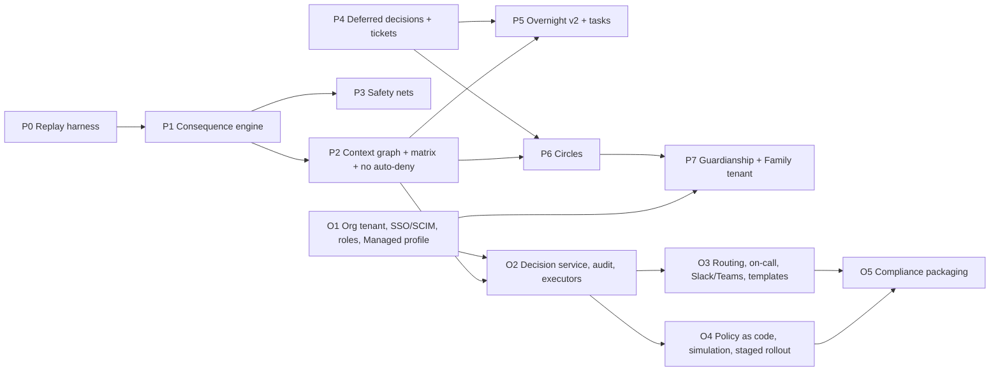

# Decisions v2: program plan

> **For agentic workers:** this is the program-level plan. Each phase has its own implementation plan in this folder
> (`2026-10-26-dv2-<phase>.md`), written in the writing-plans format and executed task by task with
> superpowers:subagent-driven-development or superpowers:executing-plans.

**Goal:** ship Decisions v2 as specified: Auto v2, async decisions, shared control, Managed organizations.

**Architecture:**
- Phases follow `07-roadmap.md`. Each phase is one branch and one PR (or a short stack) into `main`, released when
  merged.
- The consequence engine and policy live in `reins-policy`. The core (`reins-core`) wires them into the request path.
- The server (Vaultwarden fork) carries tickets, Circles routing and the org tenant. The apps add UI.

**Tech stack:**
- Rust 1.98.1 (workspace crates: `reins-proto`, `reins-policy`, `reins-core`, `reins-desktop`, `reins-desktop-app`,
  `reins-e2e`) and the server (`src/`, Rocket, Diesel).
- Kotlin/Compose (Android) and Swift/SwiftUI (iOS).
- UniFFI bindings.

**Spec:** `docs/design/decisions-v2/00-overview.md` … `08-review-resolutions.md`. Where they disagree, 08 wins.
Measurements: `docs/superpowers/specs/2026-10-26-auto-v2-design.md`.

## Global Constraints

- The authorization foundation's invariants hold (`docs/authorization*.md`):
  - mandatory deny and review always win;
  - unknown facts never widen;
  - authority is proven, never claimed;
  - receipts and budgets are spent before effects.
- **Auto never denies.** Only explicit rules deny: Lockdown, "never" rules, org deny, repo deny.
- **Notifications only for things the user must act on.** Automatic decisions are never notifications (PR #211).
- **The always-ask floor (08 R4)** is a hard `require_review`, not a matrix cell.
- **Personal mode stays end-to-end:** the server never stores request bodies, results or answers in clear beyond
  transit (08 R9, R10).
- **Toolchain and builds:**
  - pinned clippy: `PATH=$HOME/.rustup/toolchains/1.98.1-x86_64-unknown-linux-gnu/bin:$PATH CARGO_TARGET_DIR=target-198 cargo clippy -p <crate> -j 4 -- -D warnings`;
  - cargo `-j 4`, narrow `-p`;
  - Rust tests with `XDG_CONFIG_HOME` set to a temp dir under `~/Documents/dev/tmp`;
  - never use `/tmp`.
- **iOS:**
  - write the Swift on Linux and check it with `scripts/ios-typecheck.sh`;
  - the Mac (Zeron chat 09b68077) builds and runs the targeted ReinsTests, one simulator, no UI suites;
  - UI tests never gate a merge.
- **Android:** `cd android && env -u ANDROID_SDK_ROOT ANDROID_HOME=$HOME/Android/Sdk ./gradlew --max-workers=4 :app:testFullDebugUnitTest`.
- **Git:**
  - pushes go through the Reins proxy;
  - commit messages and PRs never mention AI;
  - squash merges use an explicit message with no `[skip release]` unless the change is docs-only;
  - don't merge to `main` while a release run is between start and publish (a push supersedes it).
- **UI:** copy short, as on the boards; real icons (SF Symbols, Material Symbols), never emoji; the Next look
  (`design/next/`).
- **Every phase passes the replay gate (P0)** before merge: the ask rate is reported, and real-risk recall is 100% on
  the labelled set.

## Review Focus

- **Prompt-injected agent text:** it must never lower a level or widen a zone. Agent text can only push toward Ask.
- **A request whose effects can't be fully read** (`$VAR`, `eval`, `| sh`, an unannotated MCP tool): it must ask, and
  name what couldn't be read.
- **The world changing between approve and execute** (branch moved, recipient re-zoned, policy added): revalidation
  must re-ask with a diff, never execute stale.
- **Profile crossing:** a Personal connection must never produce a Managed request, or the reverse, and an org must
  never learn a Personal profile exists.
- **Offline phone during Deferred or Circle approvals:** an approval must wait for the executor and revalidate; it must
  never execute on a server-side guess.

## Phases, dependencies and waves

| Wave | Runs in parallel | Branch prefix | Notes |
|---|---|---|---|
| 1 | **P0→P1** (one stream), **P4**, **O1** | `dv2/p0-p1-*`, `dv2/p4-*`, `dv2/o1-*` | three Rust streams at `-j 4`; P4 uses today's evaluation until P2 |
| 2 | **P2**, **P3** | `dv2/p2-*`, `dv2/p3-*` | after P1 merges; P2 includes the setup screens on both phones and the desktop |
| 3 | **P5**, **P6**, **O2** | `dv2/p5-*`, `dv2/p6-*`, `dv2/o2-*` | O2 builds on the Vaultwarden org model (`src/db/models/organization.rs`, `group.rs`, `org_policy.rs`) |
| 4 | **P7**, **O3**, **O4** | `dv2/p7-*`, `dv2/o3-*`, `dv2/o4-*` | the P7 Family tenant reuses O1's tenant |
| 5 | **O5** | `dv2/o5-*` | packaging, `reins-audit verify`, the dedicated/self-hosted executor binary, SOC 2 evidence reports |

## Per-phase protocol

1. **Plan:** a planning agent reads the spec sections for the phase and the actual code, then writes
   `docs/superpowers/plans/2026-10-26-dv2-<phase>.md` in the writing-plans format (exact files, signatures, tests,
   Interfaces blocks, Review Focus).
2. **Build:** an implementation agent executes the plan task by task, TDD, committing per task, in its own worktree
   `~/Documents/dev/reins-dv2-<phase>`.
3. **Gate:**
   - the replay gate (from P1 on);
   - CI green;
   - for Swift, the Mac's build plus targeted tests;
   - one independent security or code review (one round; findings fixed, no second loop).
4. **Merge:** squash with an explicit message, release, sync the feed, and check TestFlight.
5. **Record:** a line in `docs/design/decisions-v2/07-roadmap.md` §1 (shipped date, PR).

## Acceptance per phase

From `07-roadmap.md` §1, unchanged. The program is done when every phase's success line holds, and:

- developer ask rate ≤ 3% on replay, with 100% real-risk recall;
- Instant time to decision: median < 15 s; Deferred: median < 2 h; timeout rate < 1%;
- a pilot org (us) provisioned and deprovisioned end to end, with an audit export verified by `reins-audit verify`.
