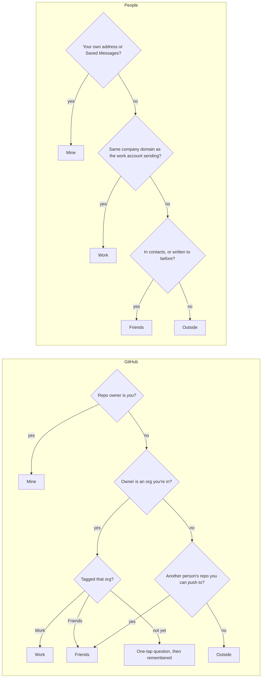
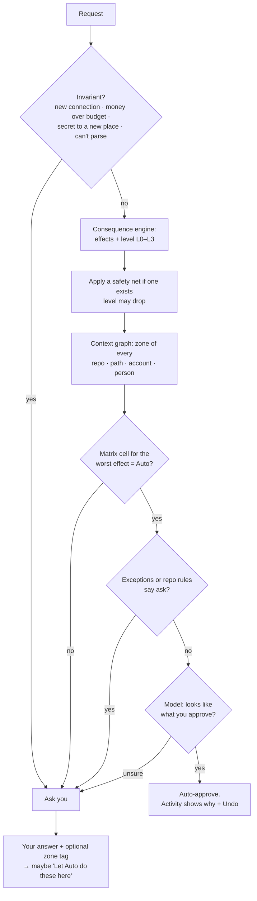
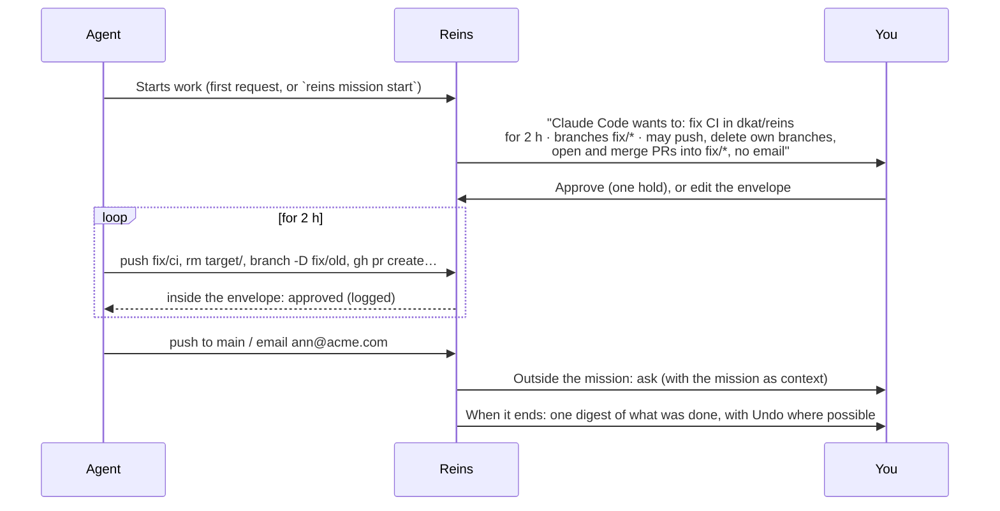
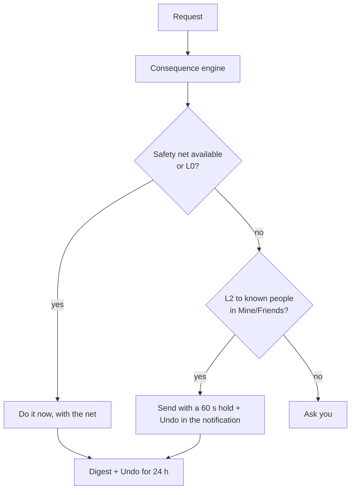
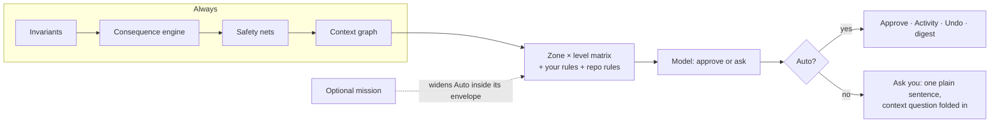

# Auto v2: a proposal (2026-10-26)

**Status: proposal for choosing.** Three directions are laid out, plus a recommended combination. Nothing here is
decided until it's picked. Pick what you like, cross out what you don't, and the chosen version becomes the design
that gets built.

## 1. Why Auto has to change

### What the user said

- Auto is "completely unusable right now". Ordinary work (deleting a merged branch, removing a worktree) can't run
  on its own without Bypass, so Reins turns into decision fatigue.
- Auto-deny makes no sense. If Auto isn't sure, the human decides; an approval that never comes is already a no.
- The same action means different things in different places: your own repo versus a friend's versus your
  company's; a personal versus a work email; who an email or message goes to.

### What the data says

Every request this computer sent through Reins, 13–26 October (from the desktop app's own activity log; it never
left this PC):

| | |
|---|---|
| Requests | **781** over 8 active days: about **100 a day**, **194** at peak (14 Oct) |
| Approved by you | **731 (94%)** |
| Denied by you | **3 (0.4%)** |
| Timed out (nobody answered) | **37 (5%)**, which is the cost of fatigue |
| Decided by Autopilot | 0: everything went to the phone |

What those 781 were:

| Kind | Count | Worth a human look? |
|---|---:|---|
| `git push` to a feature branch of your own repo | 309 | no |
| `rm -r` inside a project, worktree, scratch or build folder | 215 | no |
| `git` read of your own repo | 67 | no |
| GitHub tool calls (PR list, create, merge, checks, runs) on your own repos | 56 | almost never |
| "Reads keys/credentials" (guard match on `.ssh`, `*.key`, `.keystore`…) | 45 | **1 real; 44 false alarms** (code that only *mentions* those paths) |
| `git branch -D` / `git reset --hard` on local branches | 32 | no (recoverable) |
| "Reads `.env`" | 19 | 9 real reads (local builds); 10 false alarms |
| Force push | 14 | 12 real, all to feature branches |
| "drop table" text match | 12 | **3 real; 9 false alarms** (Python edits mentioning SQL) |
| `rm -r` outside a project (in `~`) | 7 | **yes** |
| `mkfs` text match, explicit `reins ask` questions | 7 | yes (asks are meant for you) |

Two conclusions drive everything below:

1. **About 97–98% of requests didn't need a human.** You approved them anyway, which is exactly what fatigue looks
   like. The 0.4% you denied would still reach you under every direction below.
2. **The guard reads text, not meaning.** It matches keywords in the whole command, so a Python edit that mentions
   `.ssh` looks like reading your keys. A human can't sort that out reliably either (see §3). Auto has to
   understand what a command *does*.

This sample is developer work on one computer. Email, messages and payments go through the phone's own connectors
and aren't in this log; §9 estimates them separately.

## 2. Principles (all three directions share these)

1. **Auto approves or asks. It never denies.** Denial is the human's job, or an explicit rule's (Lockdown, a
   "never" rule you wrote). When Auto isn't sure, it asks. The current "Autopilot denied" path goes away, and so do
   its notifications.
2. **Judge consequences, not text.** Every request is turned into *what it will do*: which files, inside or outside
   the project, which git refs, which people, which money, which secrets, whether it can be undone. Policy reads
   those facts, never the raw command string.
3. **Context is a first-class input: whose is it.** Mine, Friends, Work or Outside, worked out from facts the phone
   can check (§4.1), never from what the agent says.
4. **Humans decide what humans are good at** (§3): people, money, publishing, permissions, irreversible loss.
   Machines decide what machines are good at: what a command does, whether a path is safe, whether a push rewrites
   history.
5. **Turn irreversible into recoverable where possible**, then automate it (§4.3).
6. **A question costs one tap, carries its context, and teaches.** It never needs reading a command.
7. **The few invariants stay:**
   - new connections and new phones always reach you;
   - payments over a limit you set;
   - secrets leaving the device to a new place;
   - anything Reins can't read with certainty.

## 3. What humans should and shouldn't decide

Humans are poor judges of raw commands: `git push origin +HEAD:refs/heads/x`, `rm -rf "$DIR"/`, `find … -delete`,
heredocs, `curl | sh`. In the data, the "dangerous" matches were mostly false. A human tapping Approve 194 times a day
isn't reviewing anything. So:

| Decision | Who decides | How the human sees it, when asked |
|---|---|---|
| What a shell command does, and whether it's safe in this folder | **Machine** (parser plus consequence engine, §4.2) | never the command itself; in its place, one plain sentence ("Deletes 3 folders in reins-polish/target") |
| Git mechanics (push, rebase, force-push to a feature branch, delete a merged branch) | **Machine**, inside zone policy | "Rewrites feature/x on dkat/reins (backup kept)" |
| Who gets an email or message, and in whose name | **Human** at first; Auto for people you already write to | names, not addresses: "Ann (Acme, Work) and 1 new person" |
| Money | **Human**, or a budget you set | amount, merchant, card |
| Publishing to the world (public repo, release, package, public post) | **Human** | "Makes dkat/reins public" |
| Permissions (collaborators, deploy keys, tokens, branch protection) | **Human** | who gets what |
| A secret leaving the device | **Human** the first time per destination | "Sends .env to api.example.com" |
| Irreversible loss in a zone you care about (delete a repo, `rm` outside projects, drop a production DB) | **Human** | what's lost, and that no backup is possible |
| Anything Reins can't parse with certainty | **Human**, but phrased as a question about the *effect* Reins couldn't confirm | "Couldn't tell what this deletes. Allow once?" |

## 4. Building blocks (shared by every direction)

### 4.1 Context graph: whose is it

Facts the phone can verify, gathered at setup and kept fresh:



- **Accounts carry a zone too.** A Google Workspace or custom domain counts as Work; Gmail or iCloud as personal. A
  message's zone is the *least* trusted of its sender account and all its recipients.
- **Computer paths:**
  - **Workspace:** a git worktree of a known repo, `~/Documents/dev/**` (configurable), the OS temp and cache
    folders, build outputs (`target`, `build`, `DerivedData`, `node_modules`).
  - **Home:** the rest of `~`.
  - **System:** everything else.
- **Unknown always means Outside**, so it asks. The first approval in Outside offers "Remember octo as Work · Friends ·
  Mine".
- **These are verified attributes** in the authorization foundation's sense (`docs/authorization.md`): Reins never
  derives them from the agent's text or an email suffix it can't check.

### 4.2 Consequence engine: what can it break

Every request becomes a small, typed effect record, built by parsing the command or API call:

```
effects:
  files:     delete 3 paths, all in workspace (reins-polish/target, …), 0 outside
  git:       push feature/x to dkat/reins (not default), rewrites history: yes, backup ref: will be kept
  people:    none
  money:     none
  secrets:   none read, none sent
  network:   github.com (known)
  certainty: full | partial (unresolved $VAR, eval, pipe to sh, interpreter with inline code)
```

- It replaces the keyword guard for decisions. The guard's groups stay as **labels for humans**, not as triggers.
- Inline code (`python3 - <<EOF`, `node -e`) is analysed as code where possible. File writes and deletes inside the
  workspace are fine; the network, `subprocess` and paths outside are flagged.
- "Mentions `.ssh` in a string being written to a file" is not "reads `.ssh`". That alone removes about 60 false
  alarms from the sample.

Each effect gets a **consequence level**:

| Level | Meaning | Examples |
|---|---|---|
| **L0 Undoable** | nothing is lost | reads, builds, tests, `rm` in build or scratch output, pushes to a feature branch, drafts |
| **L1 Recoverable** | lost, but Reins or the service keeps a way back | delete a local or remote branch (backup ref), force-push a feature branch (backup ref), trash one email, `rm` in the workspace (moved to the trash) |
| **L2 Reaches people** | others see or receive it | send email or message, open or merge a PR, comment, publish a preview |
| **L3 Irreversible / far-reaching** | can't be taken back, or changes who can do what | delete a repo, rewrite a default branch, `rm` outside the workspace, drop a non-local DB, permissions, publishing to the public, money, secrets leaving |

### 4.3 Safety nets: making L3 into L1

Reins can wrap actions so that more of them are recoverable:

| Action | Safety net | Level drops |
|---|---|---|
| `git branch -D` / delete a remote branch | create `refs/reins/backup/<branch>/<ts>` first (kept 30 days) | L1 → L0 for Mine |
| force push | push a backup ref of the old tip first | L3 → L1 on feature branches |
| `rm -r` in the workspace | move to an OS trash or `~/.local/share/reins/trash` with a 7-day sweep | L1 → L0 |
| send an email (Gmail) | schedule send +60 s; the notification has **Undo** | L2 stays L2, but becomes cancellable |
| delete an email | Gmail's trash (already) | L1 |
| GitHub PR merge into a branch you own | revert is one tap from Activity | L2 → L1 for Mine |

Safety nets cost a little disk and time, and buy a lot of automation. Every entry in Activity shows its undo.

### 4.4 Your rules

- **In the app:** the zone × level matrix (§5), plus per-zone exceptions ("ask for anything to acme/payments").
- **In a repo:** `.reins/rules.toml`, read only from the default branch.
  - Stricter rules apply at once.
  - Looser rules show once on the phone for you to accept ("dkat/reins wants Auto for force-pushes to
    `release/*`: accept?"). Any change to the file asks again.
  - An agent can't loosen its own repo.
- **Learnt promotions:** after you approve the same kind of thing in the same zone 3 times (e.g. merging your own
  PRs in dkat/reins), the approval card offers **"Let Auto do these here"**. One tap writes a rule you can see and
  remove in Settings.

### 4.5 The model's job, after this change

Laya stays, in a narrower role:

- **Inside an "Auto" cell:** a sanity check, asking "does this look like what you approve?" The answer is approve or
  ask, never deny.
- **Writing the plain sentence** a question shows.
- **Rating risk** where the consequence engine's certainty is partial.
- **Proposing zones** at setup, from metadata only.

Memory, the adapter and agreement metrics stay, retrained on approve/ask labels. "This was wrong" on an
auto-approval becomes **"Ask me next time"**, which adds an exception rule, pauses that kind for 24 hours, and
counts three times as a training example.

## 5. Direction A: Zones × consequences (rules-first)

Policy is a matrix you can see and edit. The model only runs inside cells marked Auto.

| Whose is it | L0 Undoable | L1 Recoverable | L2 Reaches people | L3 Irreversible |
|---|---|---|---|---|
| **Mine** | Auto | Auto | Auto (to people you already write to) | Ask |
| **Friends** | Auto | Ask (first time per repo) | Auto (people you write to) | Ask |
| **Work** | Auto | Ask | Ask (Auto for colleagues after promotion) | Ask |
| **Outside** | Ask | Ask | Ask | Ask |



**Pros:**
- Predictable: you can read exactly why something asked.
- Easy to explain on one screen.
- Works from day one, with no model training needed.
- Fits the existing authorization foundation (each cell is a policy record).

**Cons:**
- The zone and level of a mixed request is its worst part. One stranger on CC makes a send ask; that's correct, but
  it's a rule, not a judgement.
- It needs good consequence parsing to avoid over-asking.

**Expected on the 781:** about **18 asks (2.3%)**, roughly **2 a day**. Breakdown:
- 7 `rm` outside the workspace;
- 6 explicit `reins ask` questions;
- 1 real credential read, 2 `.env` reads that also touch the network, 1 real local DB drop, 1 `mkfs` text match.

Everything else auto-approves, with backups for branch deletes and force pushes.

## 6. Direction B: Missions (task-scoped approval)

Instead of judging each action, you approve a **mission**: what the agent is doing, where, and for how long.
Everything inside the mission's envelope runs on its own; anything outside asks.



- An envelope has: repos and branches (globs), paths, services and operations, people (none by default), budget,
  duration, and a level ceiling (default L1, or L2 for your own repos).
- An agent can propose an envelope. You approve the envelope, not each action. The desktop's existing **work
  session** becomes the mission UI.
- Missions are per AI connection. One for Claude Code doesn't cover Codex.

**Pros:**
- Matches how agent work actually happens: a task.
- You make one decision per task, while you're thinking about the task.
- Very low fatigue during long runs. Overnight becomes "a mission while you sleep".

**Cons:**
- Someone has to start the mission: the agent proposes it, or you do.
- Envelopes that are too broad recreate Bypass.
- Ad-hoc chat work ("ChatGPT, email Ann") has no mission, so it falls back to A or asks.

**Expected on the 781:** one mission per working block (about 2–3 a day, so ~20 in the period), plus the same ~11
truly outside asks. That's **about 31 (4%)**, but the asks are *front-loaded*: you answer while starting the task,
not mid-flow.

## 7. Direction C: Undo-first (approve, then review)

Approve almost everything that has a safety net or is L0–L2 to known people, show it in a **digest**, and make
everything undoable for a window. Ask only L3 with no possible net.



- **Digest:** a quiet notification every few hours, or on request: "Claude Code did 84 things: 52 pushes, 30
  cleanups, 2 PRs merged. 3 can still be undone." You read it like an inbox, and nothing waits on you.
- Overnight is simply this, with no asks until the morning.

**Pros:**
- The fewest interruptions of all.
- Matches "the agent is mostly right; let me fix the rare mistake".

**Cons:**
- Undo isn't universal: a sent message can't be unsent after the hold.
- Digests can become another thing you ignore.
- It needs the most engineering (nets on every connector).

**Expected on the 781:** about **10 asks (1.3%)**. Even `rm` outside the workspace goes to the trash, so it becomes
recoverable.

## 8. Recommendation: A as the backbone, plus C's safety nets, with B as an option



- **A** gives a predictable, editable policy you can trust on day one.
- **C's safety nets** move most destructive developer actions into L0/L1, where A already says Auto.
- **B's missions** are an *optional* layer for long agent runs and Overnight. They widen the matrix inside an
  envelope; they never replace it.

Expected: about **2% of developer requests ask you** (roughly 2 a day at today's volume, down from ~100), and none
of them is a raw command.

## 9. Estimates beyond this computer

These are reasoned estimates, not measured: the phone connectors' history isn't on this PC.

| Area | Today | With the recommendation |
|---|---|---|
| Git and shell from coding agents | ~100% ask (Auto unusable) | ~98% auto |
| Reading your mail, calendar, contacts | asks per new target | ~95% auto (reads are L0; the first read of each account asks once at setup) |
| Sending email | asks | auto to people you've written to before in Mine/Friends, with a 60 s Undo; asks for new people, Work outside your domain, many recipients, attachments with secrets. Probably **60–80% auto** |
| Messages (Telegram, SMS) | asks | replies in existing 1:1 chats auto; new people, groups and forwards ask. Probably **70%** |
| Payments | asks | under a budget you set: auto; else asks |
| Vault secrets | always asks | stays human (first use per destination), then per-mission |

## 10. User experience: every flow

### 10.1 Turning on Auto (setup)

```mermaid
sequenceDiagram
  participant You
  participant Phone as Phone (on-device model)
  You->>Phone: Turn on Auto
  Phone->>Phone: Read metadata only: repo owners and orgs, accounts, sent-to domains and counts,<br/>contact groups, chat names and sizes (no bodies, no code)
  Phone->>You: Screen 1 · GitHub: "katulevskiy · Mine", "Acme Corp (14 repos) · Work?", "kalanov · Friends?"
  Phone->>You: Screen 2 · Email: "dkatulreg@gmail.com · personal", "you@acme.com · Work", top domains
  Phone->>You: Screen 3 · Messages: chats you're in → Friends / Work / Outside
  Phone->>You: Screen 4 · Computer: your workspace folders (~/Documents/dev, worktrees)
  Phone->>You: Screen 5 · The matrix with your names; tweak any cell
  You->>Phone: Turn on (hold + biometric)
```

- You swipe to confirm or fix each item. Anything you skip stays Outside, so it keeps asking.
- It takes about 2 minutes, and you can redo it any time in Settings › Auto › Your world.

### 10.2 A request that Auto handles

- No buzz. Activity shows it with **Auto**, the reason ("Mine · undoable · like 140 pushes you approved") and
  **Undo** if a net exists.
- Approvals are grouped in a quiet "Auto" notification channel (off by default).

### 10.3 A request that asks you

- The approval card shows **one sentence** of effect, the zone chips (Mine, Work…), and what's at stake. The raw
  command is behind "Details".
- A context question, if one is needed, is folded in: "Who is octo? Work · Friends · Outside".
- Under Approve: **Once** · **Let Auto do these here** (shown after you've approved the same thing 3 times).
- Deny is still one tap. Nothing auto-denies.

### 10.4 Correcting Auto

- On any Auto entry, **Ask me next time** (the old "This was wrong") does three things:
  - adds an exception;
  - pauses that kind for 24 hours;
  - offers Undo if a net exists.

### 10.5 Missions (if B is picked)

- **Start:** an agent proposes ("Fix CI in dkat/reins for 2 h"), or you start one from Activity's mode sheet. You
  edit the envelope and hold to approve.
- **During:** a live chip on Activity shows the mission, its time left and a count of what it did.
- **End:** time runs out, the agent says it's done, or you stop it. A digest follows.

### 10.6 Digest

- On demand, or quietly a few times a day: grouped by AI and repo, with counts, anything still undoable, and
  anything that asked.

### 10.7 Repo rules file

- Stricter rules apply silently.
- A looser rule raises a one-time card: "dkat/reins's rules want Auto for: merging PRs into main (CI green). Accept ·
  Not now".

### 10.8 Changing a zone or a cell

- Settings › Auto › Your world (zones), and › Matrix (cells), with a plain preview of what changes ("Merging PRs in
  Work repos will ask").
- Loosening a cell needs a hold and a biometric. Tightening is one tap.

## 11. Overnight, updated

Overnight becomes **"Auto while you're away"**. Two rules change, and nothing gets denied:

1. **What would ask is parked, not denied.**
   - The agent gets "deferred until morning" and keeps working on other things. Harness hooks and `reins ask`
     already support waiting.
   - In the morning, one digest of parked requests: approve or deny each, or **Approve all from this mission**.
   - The current "If something is too risky: deny it" setting goes away.
2. **People are stricter, your own work is looser.**
   - Overnight never sends to new people, never publishes, never spends.
   - It auto-approves L0–L1 in Mine and Friends with nets, including force pushes to feature branches and branch
     cleanup.

Optional: Overnight starts a **mission** (if B is picked) whose envelope you set at bedtime ("dkat/reins, fix/*, no
email, until 08:00").

Bypass stays as it is (everything, for a time) for the rare case. Lockdown stays (denies everything).

## 12. What goes away, what stays

| Goes | Stays |
|---|---|
| Auto-deny and "Autopilot denied" notifications | Manual, Lockdown, Bypass |
| The keyword guard as a decision trigger (it remains a label) | The hard invariants (new connections, new phones, money, secrets to a new place) |
| "Hard floor" items that are really L0/L1 with a net (branch deletes, force-push to feature branches, `rm` in the workspace) | Memory, adapter, agreement metrics (relabelled approve/ask) |
| Overnight's "deny if too risky" | Laya risk head (used where certainty is partial) |
| The per-kind cold-start bar (replaced by zone × level, plus the model check) | "Ask me next time" (renamed "This was wrong") |

## 13. Risks and how each direction handles them

| Risk | Mitigation |
|---|---|
| Zone misclassified (a work repo tagged Mine) | Setup shows owners, counts and members, and the zone shows on every card. Changing a zone back is one tap. L3 always asks in every zone. |
| Agent launders an irreversible act through reversible steps (e.g. many branch deletes) | Rate limits per kind per hour; a burst raises one ask: "Claude Code deleted 40 branches in 5 min: continue?" |
| Prompt injection through the repo rules file | Only the default branch counts; looser rules need your acceptance; the file can't loosen invariants. |
| Partial parse (a `$VAR`, `eval`, a pipe to sh) | Certainty "partial" forces ask unless a mission envelope covers that exact command. |
| Undo isn't actually available (a net failed) | The net is created *before* the action; if it fails, the request asks. |
| Digest blindness | Digests are optional; asks never hide in digests. |
| Model drift | The model can only turn Auto into Ask, never Ask into Auto. |

## 14. Build plan sketch (after a direction is picked)

1. **Consequence engine** (core): a shell parser with effect records, replacing the guard's triggers, plus inline-code
   analysis. Test it against the 781 real requests (labelled) before anything else.
2. **Context graph** (core and phone): zones, verified attributes, setup screens, the folded-in context questions.
3. **Matrix policy** (core): the evaluator on the authorization foundation; Auto-deny removed; "Ask me next time".
4. **Safety nets** (desktop, git proxy, Gmail): backup refs, trash, send hold.
5. **Overnight v2**: parking, the morning digest.
6. **Missions** (if picked): envelopes, the work-session UI, agent-proposed missions.
7. **Repo rules file**: parsing, the stricter/looser split, acceptance cards.

Each step is measurable on the recorded history: the share of asks should fall at every step, with no real-risk
request (the ~20 flagged in §1) auto-approved.

## 15. Questions for you

1. Which direction: **A**, **B**, **C**, or the recommended combination?
2. The matrix defaults in §5: anything you'd move (e.g. should Friends' repos auto-approve L1 with nets)?
3. Should `rm` outside the workspace ever be Auto, with the trash net (C), or always ask (A)?
4. Email: should a 60-second send hold with Undo be on by default?
5. Missions: should agents be able to *propose* envelopes, or only you start them?
